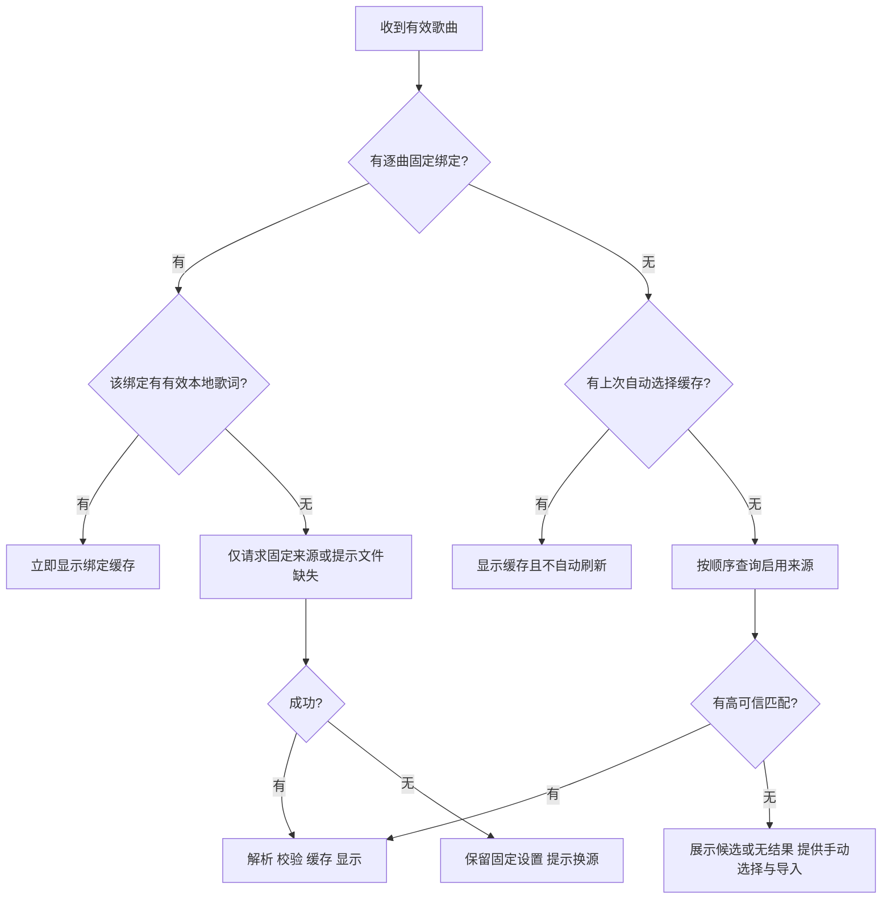

# LyricsFlow 产品需求与实现规格（PRD）

> 版本：1.1  
> 编写日期：2026-10-26（Asia/Shanghai）  
> 状态：需求澄清后的开发基线；外部服务仍需按本文门槛完成接入验证。  
> 适用范围：Android 首版及后续演进规划。  
> 原始输入：[LyricsFlow.md](./LyricsFlow.md)、[LyricsFlow.pdf](./LyricsFlow.pdf)、现有 Android 工程、与产品负责人的三轮需求确认。

> 1.1 调整：依据产品负责人新增要求，QQ 音乐、网易云的歌词与热门评论提升为 V1 优先适配；替换 1.0 中“评论仅做条件空态、两来源后续接入”的范围。接口、源码与只读探测详见 [QQ / 网易云 API 调研](./QQ-NetEase-API-Research.md)。播放状态仍优先来自本机 Spotify 媒体会话。

### 文档导航

当前原生开发版的实现范围、工程决策和未完成的发布验证，见 [Android 实现说明](./Android-Implementation.md) 与 [模拟器验收记录](./android-qa/README.md)。本文继续保留为产品与发布目标，不以开发进度倒改验收标准。

- 产品定义：[优化后的描述](#1-优化后的产品描述)、[已确认决策](#2-已确认的产品决策)、[版本范围](#4-版本范围与优先级)。
- 页面体验：[信息架构](#5-用户场景与信息架构)、[首页](#7-首页详细交互)、[评论](#8-评论页面)、[我的与设置](#9-我的及设置规格)。
- 核心能力：[播放同步](#10-播放状态与歌词同步)、[歌词来源](#11-歌词获取匹配与来源策略)、[翻译](#13-在线翻译完整规格)、[个性化](#14-个性化与原生渲染引擎)、[悬浮窗](#15-桌面悬浮窗与后台生命周期)。
- 实现约束：[数据模型](#16-本地数据模型与标识)、[文件格式](#17-文件格式导入导出与未来自定义服务)、[技术架构](#20-建议技术架构与工程边界)、[非功能要求](#22-隐私安全可访问性与非功能要求)。
- 后续能力：[GitHub 同步](#18-github-账户与同步方案v2)、[Spotify 远程](#19-spotify-官方增强与远程播放后续)。
- 开发交付：[验收用例](#23-验收用例与发布标准)、[里程碑与验证门槛](#24-开发里程碑风险与待验证清单)、[需求追踪](#25-原始需求追踪与参考资料)。

## 0. 阅读约定与边界

- **已确认**：产品负责人在本次需求澄清中明确选择的方向，见第 2 节。
- **实现基线**：为使需求可实施而补充的默认规则、交互、参数和技术方案；可在开发验证后通过变更记录调整。
- **外部依赖**：第三方服务的授权、覆盖率、接口稳定性和平台行为，不视为已经完成验证。
- **验收目标**：开发完成后需要测量或验证的目标值，不代表当前项目已达到这些指标。
- V1 指首版完整交付范围；M0～M5 是 V1 内部开发里程碑；V1.1、V2 是后续范围。不能把仅完成 M1 的版本称为完整 V1。
- 本文提供产品需求和关键实现约束，不表示应用功能已经实现。当前代码仍是 Compose 初始模板。
- 本次不改写原始 Markdown 和 PDF，避免丢失参考图、原始意图及历史依据。

## 1. 优化后的产品描述

LyricsFlow 是一款原生 Android 歌词伴侣应用，优先服务于在本机使用 Spotify 听歌的用户，并兼容能够暴露有效 Android 媒体会话的其他音乐应用。

应用读取当前歌曲、歌手、专辑、封面和播放状态，优先从 QQ 音乐、网易云音乐匹配歌词和歌曲评论，以 LRCLIB 等补充覆盖，优先复用本地缓存，并根据播放进度同步展示原文、中文翻译及数据源已有的罗马音。用户可以为每首歌固定歌词来源和匹配结果，手动更换版本、刷新歌词或调整歌词时间偏移。

应用包含“首页”和“我的”两个主入口，并提供歌曲评论页。首页突出歌曲信息和歌词阅读体验；“我的”集中管理播放来源、桌面歌词、翻译、歌词来源、个性化、数据与帮助。评论仅展示从真实可用来源获得的内容。

首页及桌面悬浮窗共享统一的歌词数据与时间轴。通过版本化声明式配置，将内容、视觉样式和动画行为分离，预设“经典滚动”和“自由排版”两种展示模式，支持配置导入、预览和导出。首版不执行任意 JavaScript、HTML 或远程代码。

应用以本地优先、无必需自建后端、美观流畅和低功耗为原则。首版先面向个人使用与 APK 分发，保留未来开源能力；GitHub 资料同步及 Spotify 远程播放作为后续可选扩展。

## 2. 已确认的产品决策

| 编号 | 已确认结论 | 对实现的约束 |
| --- | --- | --- |
| D01 | 先个人使用和 APK 分发，保留未来开源能力 | V1 不以应用商店审核和公众 Spotify 配额为前提；不将密钥提交到代码库 |
| D02 | 优先本机 Spotify，兼容其他本机音乐 App；远程播放后续支持 | V1 采用本机媒体会话；不承诺同步电脑、音箱上的播放 |
| D03 | 配置文件控制布局、字体、颜色和时间轴动画，不执行任意代码 | 使用 JSON 配置与原生渲染引擎；不存在脚本插件运行时 |
| D04 | 必须逐行同步；有真实逐字时间戳时支持逐字高亮 | V1 包含逐字数据模型、解析与高亮；无逐字数据时降级逐行 |
| D05 | 首版仍尽量无自建服务，优先完成 QQ、网易云歌词与评论接入 | 原生匿名只读直连为首选；V1 兼容固定社区网关协议作为可选路径，不强制部署、不硬编码公共代理 |
| D06 | 在线翻译使用用户提供的 OpenAI 兼容 URL、Key、模型；确认后自动翻译并缓存 | 无内置共享付费 Key；首次启用需确认数据发送及可能费用 |
| D07 | 锁屏隐藏；暂停保留当前歌词，5 分钟后隐藏；恢复播放后自动显示 | 区分“用户开启桌面歌词”和“窗口此刻可见”；受系统服务存活状态约束 |
| D08 | 首版尽量实现 QQ、网易云两套真实热评适配；运行时无结果或故障时解释原因 | 两套适配器和真实联调属于 V1 工作，不能只做空页面；短时故障不阻断歌词，不伪造评论 |
| D09 | GitHub 登录、同步在后续版本实现，PRD 先写完整方案；首版本地导入导出 | V1 核心功能无应用账户依赖；GitHub 模块不得阻塞首版 |
| D10 | 来源附带罗马音时显示；首版不自动生成注音 | 支持可选注音轨道与开关；不承诺所有日语歌曲有注音 |
| D11 | 优先支持 QQ 音乐、网易云，因为二者同时提供歌词与评论；允许研究官方及非官方文档 | 新增确认覆盖 1.0 的来源优先级；目标为双平台真实链路，至少一个平台真实热评通过后才可宣称首版评论可用 |

后文未另标“已确认”的数值和交互均为实现基线。例如默认字号、缓存容量、重试次数可以依据实机验证调整，但不得暗中削减 D01～D11。D05、D08 已按新增指示修订；“至少一个真实热评来源”的最低门槛是对“首版尽量双平台”的实现基线，不代表用户放弃另一套适配。

## 3. 目标、非目标与成功标准

### 3.1 核心目标

1. 用户在本机音乐 App 播放歌曲后，打开 LyricsFlow 即可看到当前歌曲及匹配歌词。
2. 已成功获取并保留的歌词可以离线再次显示，同一首歌不重复消耗歌词与翻译请求。
3. 用户在其他 App 中继续阅读原文和中文译文，且可以拖动、缩放、锁定桌面歌词。
4. 用户通过可导入导出的配置改变歌词布局与动画，首页和悬浮窗保持内容与进度一致。
5. 网络、服务授权、系统权限或歌词覆盖不足时，界面准确解释状态并给出可执行的下一步。
6. 从本机 Spotify 的歌曲信息匹配到 QQ / 网易云同版本歌曲，在评论页阅读该平台真实热门评论，并能独立切换来源。

### 3.2 V1 非目标

- 音频播放、下载、转码、录音识曲、独立音乐曲库或歌单管理。
- Spotify 电脑端、音箱、其他手机的远程播放同步。
- 任意 HTML/CSS/JS 执行、远程脚本、插件市场和完整可视化动画编辑器。
- 自动生成逐字时间戳、自动罗马音、机器估算逐字时间并冒充真实同步。
- 评论发布、点赞、回复、评论社区和第三方音乐账户登录。
- GitHub 登录与云同步、官方后端、内置免费翻译配额。
- 在系统强制停止后自行复活、绕过锁屏或系统敏感页面、保证所有厂商后台常驻。

### 3.3 成功标准

| 维度 | V1 验收目标 | 测量条件 |
| --- | --- | --- |
| 本机识别 | 在适配清单内，收到有效媒体回调后 1 秒内更新歌曲标题 | 不含音乐 App 自身延迟发布元数据的时间 |
| 缓存命中 | 本地歌词读取与首次内容呈现 P95 ≤ 500 ms | Release 构建、歌词 ≤ 2,000 行、指定测试设备 |
| 逐行同步 | 可控回放数据的行切换误差 P95 ≤ 200 ms | 输入时间轴准确、无手动偏移；与上游进度误差分开记录 |
| 逐字同步 | 正确消费输入时间戳；可控回放下高亮误差 P95 ≤ 100 ms | 至少一组真实格式样本及一组自有合成样本 |
| 稳定性 | 60 分钟连续听歌、切歌、前后台和悬浮窗操作无崩溃、ANR | 固定验收脚本，覆盖断网和权限撤回 |
| 流畅度 | 60 Hz 基准设备，经典模式稳态帧耗时 P95 ≤ 16.7 ms | 预热后连续 3 分钟；自由排版目标 P95 ≤ 24 ms |
| 省电行为 | 不因逐帧动画发网络请求；不可见时停止帧循环；不使用常驻唤醒锁 | 通过日志计数、帧跟踪与系统电量工具验证 |

性能指标是初始工程预算。M0 必须记录实际设备型号、系统、刷新率和测量方法；如不达标，先简化特效再决定是否修订预算。

## 4. 版本范围与优先级

| 功能 | V1 交付要求 | 后续演进 |
| --- | --- | --- |
| 播放状态 | 系统媒体会话；Spotify 优先；其他应用按兼容性清单接入 | Spotify App Remote 可选增强、Web API 远程模式 |
| 首页 / 我的 | 完整导航、设置、状态反馈；亮色 / 暗色 / 跟随系统 | 大屏专门布局、更多主题 |
| 歌词源 | QQ 音乐、网易云优先接入；LRCLIB / 本地补充；Better Lyrics 受限能力作为补充 | LrcShare、其他经过验证的来源 |
| 逐字歌词 | 真实时间戳解析、经典模式逐字高亮；自由排版可降级逐行 | 更多歌词方言、合唱复杂动画 |
| 翻译 | 来源已有中文译文；用户自配 OpenAI 兼容翻译 | 传统翻译服务适配器、更多目标语言 |
| 个性化 | 两个原生预设、参数设置、JSON 导入导出、预览回滚 | 可视化时间轴编辑器、逐曲主题覆盖 |
| 悬浮窗 | 拖动、缩放、锁定、双语、横竖屏适配、暂停 / 锁屏策略 | 经系统验证的更多展示形态 |
| 评论 | QQ 与网易云热评适配、同曲映射、来源切换、分页 / 去重、缓存、真实联调及故障状态 | 更丰富排序、跨平台聚合排序、楼层与时刻评论 |
| 来源连接 | 原生直连优先；V1 提供 QQ / 网易云固定社区网关协议、Base URL、可选网关访问令牌及分能力测试 | 任意自定义业务服务协议与可视化映射 |
| 数据 | 本地缓存、逐曲来源 / 偏移、歌词与配置导入导出、备份恢复 | GitHub 私有仓库同步 |
| 账户 | 本地使用，无强制应用账户 | GitHub 可选登录；Spotify 远程授权独立管理 |

**V1 最低可发布组合**：本机媒体会话 + QQ / 网易云两套目录、歌词和热评适配器 + 至少一个平台真实热评链路通过 + LRCLIB / 本地补充 + 经典滚动 + 真实逐字能力 + 自由排版 + 用户自配翻译 + 悬浮窗 + 两主页面 + 本地备份。目标是 QQ 与网易云均可实际读取；另一平台若受外部条件阻断，须完成适配、可复现诊断及补救路径并在发行说明披露。不能把双方均无真实数据的评论空页当作完成。

QQ / 网易云分别标记搜索、歌词、评论的可用状态，不因一种能力故障隐藏另一种能力。既有歌词仍可显示；来源故障不阻断运行中的歌词，但首版评论交付仍受上述真实链路门槛约束。LRCLIB、本地真实逐字和已适配的 Better Lyrics 可作为补充，不挤占双平台主线。

## 5. 用户场景与信息架构

### 5.1 核心场景

| 场景 | 用户动作 | 预期结果 |
| --- | --- | --- |
| 首次使用 | 打开应用，查看说明，授权通知访问，播放音乐 | 显示歌曲并查找歌词；悬浮窗和翻译分别按需启用 |
| 再听同一首 | 在相同音乐 App 播放已缓存歌曲 | 使用已绑定版本；不自动覆盖用户选择 |
| 歌词错误 | 打开来源 / 候选面板，选中正确歌曲版本 | 预览、确认、保存逐曲绑定，立即生效 |
| 海外歌曲无译文 | 配置兼容 API，确认自动翻译 | 保留原文，后台分批翻译，成功内容逐步显示并缓存 |
| 切到聊天 App | 已开启桌面歌词 | 悬浮窗继续跟随音乐，不抢占其他 App 焦点 |
| 导入主题 | 从系统文件选择器选择配置 | 校验、预览、应用或取消；错误配置不覆盖当前设置 |
| 无网听歌 | 播放有缓存的歌曲 | 继续使用原文、译文、绑定和偏移；评论说明离线状态 |

### 5.2 页面结构

```text
应用
├─ 首次使用说明 / 权限引导（按需）
├─ 首页
│  ├─ 当前播放来源与歌曲信息
│  ├─ 歌词渲染区域
│  ├─ 来源与候选选择面板
│  ├─ 歌词偏移面板
│  └─ 歌曲评论页
└─ 我的
   ├─ 使用状态 / 账户与连接
   ├─ 播放来源
   ├─ 桌面歌词设置
   ├─ 翻译设置
   ├─ 歌词源设置
   ├─ 个性化设置与主题预览
   ├─ 数据管理 / 导入导出 / 备份恢复
   ├─ 帮助与反馈
   └─ 关于 / 来源声明 / 隐私说明
```

### 5.3 导航规则

- 底部 Dock 只有“首页”“我的”两个入口；切换保留各页面的正常 UI 状态，不重复连接播放源。
- 评论、设置、预览为二级页面，系统返回回到原入口；未保存表单返回时询问是否放弃。
- Dock 使用圆角胶囊、半透明表面、高光描边和选中滑块表达玻璃质感。支持时使用有限模糊，旧系统与省电模式采用半透明纯色降级。
- 文本和按钮的可读性优先；不要求 Android 精确复刻 iOS 私有视觉效果。
- 遵守系统手势区域、屏幕切口和横竖屏 Insets；Dock 不覆盖歌词最后一行或主要操作。

## 6. 首次启动、权限与使用闭环

### 6.1 首次启动流程

1. 展示简短说明：本应用提供歌词，不播放音乐；读取用户选择的音乐应用的媒体状态。
2. 可先浏览预设说明与设置，不强迫授予全部权限。未连接时首页显示“请先播放音乐并开启通知访问”。
3. 用户点击“连接本机音乐”后说明通知访问用途，再跳转系统设置；返回时重新检查实际状态。
4. 首次连接默认监听 Spotify；检测到其他媒体会话时显示选择入口，用户可启用其他应用。
5. 有有效歌曲时自动查缓存及已启用的歌词服务；无数据时提供“重新查找”“导入歌词”。
6. 用户首次开启“桌面歌词”时再申请悬浮窗权限，并引导通知权限；回到应用确认权限后才启动窗口。
7. 用户首次开启在线翻译时再配置服务及确认传输；默认不发送歌词给翻译服务。

### 6.2 权限清单

| 能力 | 权限 / 系统入口 | 申请时机 | 拒绝或撤回后的行为 |
| --- | --- | --- | --- |
| 网络访问 | `INTERNET`、`ACCESS_NETWORK_STATE` | Manifest 普通权限 | 断网按缓存与重试规则处理 |
| 本机媒体会话 | 用户启用 `NotificationListenerService` 的通知访问 | 点击连接本机音乐 | 显示未连接；保留本地数据，不反复弹出系统设置 |
| 桌面歌词 | `SYSTEM_ALERT_WINDOW` 特殊访问 | 第一次手动开启桌面歌词 | 保持首页可用；窗口关闭，显示恢复指引 |
| 服务通知 | Android 13+ `POST_NOTIFICATIONS` | 启用桌面歌词时说明 | 拒绝不等于禁止启动 FGS；说明可能无法从通知栏操作，并保留应用内停止入口 |
| 前台服务 | `FOREGROUND_SERVICE`；Android 14+ 对应类型权限 | 随用户明确开启桌面歌词会话 | 启动失败回到关闭状态，给出原因，不崩溃 |
| 导入导出 | Storage Access Framework / 系统文件选择器 | 用户执行导入导出 | 取消即无变更；无需全盘存储权限 |
| 自定义背景 | 系统照片选择器或 SAF 图片选择 | 用户选择图片 | 取消即保留原背景；导入后保存应用私有副本 |

通知访问是系统级能力，权限说明必须如实告知其可访问范围；应用逻辑仅处理用户允许的媒体包名及媒体会话，不采集聊天通知。`BIND_NOTIFICATION_LISTENER_SERVICE` 是声明在服务上的系统绑定权限，不作为普通运行时权限请求。普通应用不依赖系统级 `MEDIA_CONTENT_CONTROL` 权限。依据：[MediaSessionManager](https://developer.android.com/reference/android/media/session/MediaSessionManager)、[NotificationListenerService](https://developer.android.com/reference/android/service/notification/NotificationListenerService)。

不申请麦克风、无障碍、定位、通讯录、全盘文件访问；不使用这些权限补救媒体接口缺失。

## 7. 首页详细交互

### 7.1 布局与视觉层级

| 区域 | 内容与规则 |
| --- | --- |
| 顶部状态 | 不显示独立品牌／聆听状态栏，保留歌词区下方的播放来源与必要状态提示，把空间留给歌词 |
| 歌曲信息 | 2026-10-27 修订：歌名 25 sp、歌手 15 sp；均限制一行，溢出后从右向左缓慢滚动（26 dp/s，首次及循环间隔 1.6 秒）；减少动态效果时停用自动滚动；无溢出不滚动 |
| 歌词主体 | 占据主要剩余高度；原文、译文、可选罗马音；当前行突出，历史 / 未来行降低强调 |
| 底部工具区 | 歌词源、拉取歌词、桌面歌词、翻译、评论；窄屏可分两行或打开“更多”面板，但五项能力均有明确入口 |
| 扩展入口 | 歌词信息、候选切换、偏移、导入歌词；不挤占核心歌词区域 |
| 底部 Dock | 首页 / 我的，与歌曲操作区分隔 |

字号是初始设计值，支持系统字体缩放与个性化覆盖。歌手是歌曲表演者信息；没有数据时显示“未知歌手”，不擅自推断词作者或曲作者。

### 7.2 主状态

| 状态 | 显示内容 | 可执行操作 |
| --- | --- | --- |
| 未授权 | 连接说明 | 开启通知访问、查看帮助 |
| 已授权无会话 | “等待播放音乐” | 打开 Spotify、切换播放来源、浏览设置 |
| 有会话缺元数据 | “等待歌曲信息” | 查看诊断；不拿空标题搜索 |
| 查找中 | 歌曲信息 + 轻量加载状态 | 取消查找、导入歌词；切歌自动取消过时显示 |
| 已命中缓存 | 立即展示内容，来源面板标记“本地缓存” | 正常显示、手动刷新 |
| 无匹配歌词 | “未找到匹配歌词” | 调整搜索词、选择候选、换源、导入 |
| 纯音乐 | “此曲为纯音乐” | 手动纠正绑定、换源；不触发翻译 |
| 仅纯文本 | 展示全文，标记“暂无时间轴” | 手动滚动；不伪造自动逐行高亮 |
| 时间轴存在但播放位置未知 | 展示歌词，标记“无法读取播放进度” | 手动浏览；位置恢复后自动同步 |
| 网络 / 来源故障 | 保留已有歌词；非阻断提示 | 重试、查看来源状态 |
| 播放暂停 | 保留当前高亮位置 | 浏览歌词；恢复播放后同步 |

演示内容只允许在明确标注的预览 / 开发模式中出现，不能在正式首页冒充正在播放歌曲。

### 7.3 滚动与同步

- 经典模式默认当前行位于歌词视口约 40% 高度；当前行切换用短距离平滑滚动，避免整屏弹跳。
- 用户触摸滚动进入“手动浏览”，暂停自动居中，显示“回到当前歌词”；5 秒无操作后恢复自动跟随，可设置为仅手动恢复。
- 单击歌词行可选中 / 查看，不触发音乐跳转。V1 不提供播放、暂停或 seek 控制，避免把阅读操作和音乐控制混淆。
- 时间轴跳变或歌曲切换时直接定位或使用短淡入，不播放跨越几十行的长滚动动画。
- 首页和悬浮窗共享同一首歌的有效时间偏移、当前行索引和翻译数据；各自允许不同视觉主题和翻译显隐。

### 7.4 歌词源与候选面板

- 面板列出“自动”“本地文件”和已可用来源，显示本曲当前来源、同步级别、是否含中文译文与缓存时间。
- 选择新来源先查本地对应缓存，再查该来源；成功预览后确认“用于此歌曲”，原绑定在确认前保持有效。
- 同名多版本显示标题、歌手、专辑、时长、版本标签与歌词片段，标出匹配度及差异。
- 固定来源但失败时，提示“该来源暂不可用，可使用其他来源”，不静默改写固定绑定。
- “本曲使用自动选择”清除固定来源 / 候选锁定，保留缓存和偏移设置。
- 来源凭证失效时直接指向对应设置；不可用来源不出现在默认自动搜索队列。

### 7.5 拉取歌词按钮

1. 当前为固定来源：刷新当前绑定的歌词记录；记录已失效时重新搜索该来源候选。
2. 当前为自动模式：按启用来源策略重新查找，允许绕过本地查找结果缓存，但仍遵守服务端缓存与限流。
3. 成功并完成解析后原子替换；失败保留旧歌词、翻译和来源绑定。
4. 连续点击合并为同一任务；按钮加载中可取消，至少 3 秒防重复触发。
5. 本地文件不执行网络刷新；点击后提示“本地歌词，请重新导入以更新”。
6. 新原文内容哈希变化时，不把旧机器翻译贴到新歌词上；按新版本重新匹配译文与翻译缓存。
7. 切歌后旧任务不得更新新歌页面；允许只将已完成且仍有效的结果写入其原歌曲缓存。

### 7.6 时间偏移

- 每首歌、每个歌词版本独立保存偏移，范围 −10,000～+10,000 ms，默认 0。
- 提供“歌词提前 100 ms”“歌词延后 100 ms”“归零”和数值输入；连续调节可按 500 ms 步进。
- 定义 `effectivePositionMs = playbackPositionMs - delayMs`：正偏移表示歌词延后，负偏移表示歌词提前。界面只使用“提前 / 延后”，避免符号歧义。
- 显示原文、译文、逐字高亮均使用同一有效时间；更换候选时加载该版本自己的偏移。

## 8. 评论页面

### 8.1 页面与数据

- 从首页进入时固定显示进入时那首歌的评论；后台切歌后展示“当前播放已切换，查看新歌评论”横幅，不突然替换阅读中的列表。
- 标题区显示歌曲、歌手、评论来源和匹配版本；提供“网易云音乐”“QQ 音乐”两个来源标签，评论来源不与歌词来源强绑定。
- 每条评论必须有用户名、正文、来源；头像、时间、点赞数为可选字段，缺失时不编造。
- 默认加载来源返回的热门列表；有分页才显示“加载更多”，无分页不制造假分页。
- 正文初始最多 6 行，可展开 / 收起；不提供发布、点赞、回复。
- 支持打开来源歌曲页面；网络返回的评论只按纯文本处理，不执行 HTML。

### 8.2 条件可用规则

| 情况 | 页面行为 |
| --- | --- |
| 两个平台当前都不可用 | 显示各自错误与最近测试状态，提供重试、连接设置或使用缓存；此为运行期降级，不代表首版评论交付已完成 |
| 有提供者但未匹配歌曲 | 显示“未找到此版本歌曲的评论”，支持换候选或查看来源 |
| 来源不允许 / 不支持评论 | 显示该来源能力说明；不向无关接口请求 |
| 网络失败但有缓存 | 展示缓存并标记更新时间和离线状态 |
| 无缓存且请求失败 | 显示原因、重试；返回首页保持歌词状态 |
| 正常返回空列表 | 显示“暂无热门评论”，与网络错误区分 |

V1 必须交付 `QqCommentsProvider`、`NeteaseCommentsProvider` 及真实联调记录，同时使用自有测试数据验证边界；不将测试数据注入正式环境。QQ 优先新版 musicu 热评；网易云优先热评接口，普通评论返回的真实 hotComments 可作降级。具体契约见第 11.6～11.8 节和 [API 调研](./QQ-NetEase-API-Research.md)。

### 8.3 来源选择与同曲校验

- 默认跟随当前歌词所属平台：QQ 歌词优先 QQ 评论，网易云歌词优先网易云评论；其他歌词源默认网易云。用户手动选过评论来源时按逐曲偏好恢复。
- 只请求当前选中标签的评论；另一标签点击后才查平台映射与评论，不在每次切歌时并发抓两边。
- 复用已确认的同平台歌曲映射，但评论选择与歌词修订相互独立；换评论来源不切换歌词、翻译或时间偏移。
- 未建立映射时先搜索 / 详情校验，再获取评论；匹配不明确时先选候选，不能用同名翻唱或 Live 版本冒充同曲。
- QQ 搜索受限时，允许粘贴受支持的官方歌曲链接或输入 ID / MID，详情校验后人工绑定；网易云同样支持数字歌曲 ID / 官方单曲链接。只解析白名单歌曲链接，不任意抓取外部 URL。
- 某来源受限时可提示尝试另一来源；自动建议不能悄悄改写逐曲偏好或把两个来源评论混在一起。

### 8.4 评论字段与分页

- 统一评论模型至少包括 `providerId`、`platformTrackId`、`commentId`、`authorName`、`content`、可选头像 / 点赞数 / 发布时间；用户名缺失显示“匿名用户”。
- 去重键为 `providerId + platformTrackId + commentId`；QQ 的 `SeqNo` 是分页序列，不是评论主键，网易云数字 commentId 也按字符串保存。
- 不跨平台比较“热度分数”合并排序；各标签保留来源顺序。首版重点保证真实热评首屏和可用分页，不扩展成评论发布功能。
- QQ 新版按 HasMore、PageNum 和末条 SeqNo 续页；网易云按具体接口的 offset / before / cursor 续页。缓存键同时包含提供者、歌曲、排序、页 / 游标与协议版本。
- 处理重复置顶、返回数量与请求数量不一致、空页、HasMore 为真但游标不前进；一页无新增或游标重复时停止自动续页，保留已读内容。
- 正文中的实体、换行和表情标记安全转换为可读文本；图片 / 音频评论 V1 只显示文字或“此评论包含媒体”，不执行嵌入内容。

## 9. “我的”及设置规格

### 9.1 首页入口

“我的”顶部显示本地使用状态、当前播放来源、关键权限状态与缓存占用；V1 不显示虚假的“已登录”用户头像。账户与连接页说明“当前无需应用账户”，并显示“GitHub 同步：后续版本”。

### 9.2 设置项与默认值

| 分组 | 设置 | 默认值 / 范围 | 保存与生效 |
| --- | --- | --- | --- |
| 外观 | 应用主题 | 跟随系统 / 亮色 / 暗色 | 全局，即时 |
| 外观 | 减少动态效果 | 跟随系统，允许主动开启 | 全局，影响首页与悬浮窗 |
| 播放来源 | 启用的音乐应用 | Spotify 默认优先，其他由用户选择 | 本机，不跨设备同步 |
| 播放来源 | 会话选择 | 自动，支持固定当前来源 | 会话期间固定；失效后提示，不随机跳源 |
| 桌面歌词 | 总开关 | 关闭 | 用户手动开启，权限就绪后生效 |
| 桌面歌词 | 显示内容 | 原文 + 译文；罗马音关闭 | 独立于首页显隐，使用共享数据 |
| 桌面歌词 | 暂停隐藏 | 5 分钟 | V1 固定默认，可提供 0 / 1 / 5 / 永不四档 |
| 桌面歌词 | 锁屏显示 | 隐藏 | V1 不提供绕过锁屏选项 |
| 桌面歌词 | 字号 / 颜色 / 背景透明度 | 原文 22 sp、译文 16 sp；由主题定义 | 提供即时预览和重置 |
| 桌面歌词 | 位置 / 尺寸 / 锁定 | 默认顶部安全区以下，未锁定 | 横竖屏分别保存 |
| 翻译 | 首页显示译文 | 开启 | 只控制显示，不自动授权在线翻译 |
| 翻译 | 在线自动翻译 | 关闭 | 完成服务配置与确认后方可启用 |
| 翻译 | 目标语言 | 简体中文 `zh-Hans` | V1 固定 |
| 翻译 | URL / Key / 模型 | 空 | 显式保存，Key 仅本机加密存储 |
| 翻译 | 重新翻译 | 当前歌手动操作 | 不覆盖来源译文，保留旧成功版本至替换成功 |
| 歌词源 | 启用与顺序 | QQ → 网易云 → LRCLIB；Better Lyrics 验证通过后补充 | 按能力就绪情况跳过故障路径，不覆盖逐曲固定选择 |
| 歌词源 | QQ / 网易云连接 | 默认匿名原生直连；可选固定协议网关、Base URL 和访问令牌 | V1 提供，不强制部署；测试分别报告搜索 / 歌词 / 热评 |
| 评论 | 来源与排序 | 跟随歌词平台，其他默认网易云；默认热门 | 逐曲保存手动来源选择，评论源不影响歌词源 |
| 歌词源 | 来源状态 | 可用 / 受限 / 需配置 / 暂不可用 | 显示最近诊断，测试连接需用户触发 |
| 个性化 | 首页主题 | 经典滚动 | 首页独立设置 |
| 个性化 | 悬浮窗主题 | 简单双语主题 | 与首页共享引擎、配置可独立 |
| 个性化 | 罗马音显示 | 关闭 | 源已有数据时可显示；缺失即不占位 |
| 色彩 | 应用配色 | 苔绿；保留已选偏好 | 五种选项，含跟随封面；配色与背景独立 |
| 背景 | 首页背景 | 柔和渐变与水流曲线 | 可切换清晰封面与自定义图片 |
| 数据管理 | 缓存上限 | 自动数据 100 MiB；其中图片软上限 40 MiB | 实际上限可调，范围 50～500 MiB |
| 数据管理 | 自动查歌词 | 开启 | 仅有可见首页 / 已启用桌面歌词会话时进行 |
| 数据管理 | 导入 / 导出 / 清理 | 按数据类别选择 | 操作前显示范围与结果数量 |

### 9.3 设置交互

- 简单开关立即持久化；API 表单使用“测试连接”“保存”两个动作，测试成功不等于自动保存。
- 无效值显示到字段，保留输入，不默默改用其他地址或模型。
- “恢复默认”按页面分组执行；清空歌词缓存不重置主题、偏移和 API 凭证。
- 用户清除全部应用数据前显示将删除的类别；退出应用、取消导入、返回页面不视为删除确认。
- 帮助包含权限教程、歌词版本不对、时间偏移、无译文、悬浮窗不显示、厂商后台限制、来源故障排查。
- 反馈默认生成脱敏诊断预览，用户主动选择系统分享；V1 不自动发送邮件、不自动上传日志。
- 关于页显示版本、构建信息、开源依赖许可、数据来源链接和隐私说明；项目地址未确定时不填虚假链接。

## 10. 播放状态与歌词同步

### 10.1 V1 数据来源

使用 Android `MediaSessionManager` 获取允许访问的活动会话，通过 `MediaController` 回调获取 `MediaMetadata` 和 `PlaybackState`。通知访问用于获得合法访问能力；通知正文不能作为精确进度来源。

读取字段：应用包名、媒体 ID / URI、标题、歌手列表、专辑、时长、封面、播放 / 暂停状态、位置、播放速度、状态更新时间、会话是否销毁。所有外部字段允许缺失，缺失不导致崩溃。

V1 不要求用户登录 LyricsFlow 的 Spotify 账户，也不依赖统一分发的 Spotify Web API Client ID。Spotify 中的广告、播客、直播、信息不完整或无法确定是音乐的内容不自动搜索歌词，显示相应状态。若媒体会话无法区分内容类型，只在标题与歌手足够可信时尝试，并允许用户纠正。

### 10.2 多会话仲裁

优先级依次为：

1. 用户当前明确固定且仍有效的会话。
2. 用户允许列表内、正在播放、元数据有效的 Spotify 会话。
3. 允许列表内最近进入播放状态、元数据有效的其他会话。
4. 最近有效的暂停会话，仅用于保留阅读内容。

自动模式不因短视频、浏览器或来电通知抢占歌词，除非用户主动将其加入音乐应用允许列表。两个候选同优先级时保持当前会话，避免反复切换。会话固定失效后显示“所选播放来源已断开”，提供恢复自动选择，不能静默订阅另一设备或账户。

### 10.3 位置计算与校准

```text
若状态为 PLAYING 且 position / updateTime / speed 有效：
  positionNow = positionAtUpdate
              + (elapsedRealtimeNow - lastPositionUpdateTime) * playbackSpeed
若状态为 PAUSED：
  positionNow = positionAtUpdate

positionNow = clamp(positionNow, 0, duration)  // duration 已知时
effectivePosition = positionNow - selectedLyric.delayMs
```

- 使用单调时钟 `elapsedRealtime`；不使用系统日期作为逐行同步时钟。
- `PlaybackState` 没有有效更新时间时以收到样本的本机时刻建立低可信锚点；位置为未知时不继续猜测自动滚动。
- 回调中的暂停、seek、速度变化、切歌立即重建锚点。不能把“很久没有回调”直接判定为停止，因为正常播放可能不持续推送位置。
- 前台恢复、屏幕解锁、会话重连时主动读取一次状态；有效可见会话可每 15 秒轻量校准一次本机控制器，不进行网络轮询。
- 校准差异 ≤ 100 ms 时保持；100～500 ms 允许在 200 ms 内平滑修正；超过 500 ms 或发生 seek 时直接重定位。
- 播放到已知时长后停在末行，等待来源真实切歌，不自行推断下一首。
- 引擎仅输出时间轴状态；不同界面的动画可使用本地帧时钟插值，不以每帧数据库写入或全屏状态重组驱动。

### 10.4 歌曲切换与任务隔离

- 歌曲切换由稳定媒体标识或可信元数据签名变化识别，不能仅凭标题判断。
- 每次有效切歌生成 `trackGeneration`；异步结果必须同时核对歌曲 ID、代次和请求类型。
- 元数据先标题后歌手分批到达时，最多等待 500 ms 合并更新，防止对不完整签名连续发起搜索。
- 旧歌曲翻译可取消；已经返回的旧结果允许缓存到旧歌曲，但绝不显示到新歌。
- 丢失会话时冻结最后可信状态并显示断开提示；超过 30 秒仍无有效会话则首页进入等待，桌面歌词隐藏。旧歌词仍可从本地数据管理访问。

### 10.5 兼容性承诺

“兼容其他音乐 App”指其提供足够的系统媒体会话数据。M0 建立实测表，至少记录 Spotify 及两款实际可用音乐 App 的包名、版本、进度、切歌、封面、暂停、后台回调能力。能力不足时明确标记“仅歌曲信息”或“暂不支持同步”，不得宣传全部音乐 App 都能精确同步。

## 11. 歌词获取、匹配与来源策略

### 11.1 提供者能力模型

每个提供者声明 `search`、`fetchById`、`plain`、`lineSync`、`wordSync`、`translation`、`romanization`、`comments`、`requiresCredential`、`supportsForceRefresh` 等能力。界面由能力决定入口，不因名称类似而假设两个服务可共用歌曲 ID。

QQ 与网易云为 V1 优先平台，必须分别实现目录匹配、歌词与评论能力。LRCLIB / 本地为补充覆盖，LrcShare、Lyrics.com、lrc.red 为后续来源；不能继续将 QQ / 网易云整体留在“计划支持”。

| 来源 | 核实情况与 V1 安排 | 失败 / 限制策略 |
| --- | --- | --- |
| QQ 音乐 | V1 优先：新版 Mobile 搜索 / 详情研究路径、行级歌词、新版 musicu 热评；兼容固定社区网关 | QQ 旧评论本次 500，新热评成功；最小 Desktop 搜索成功码但空候选，搜索能力需重点验证 |
| 网易云音乐 | V1 优先：搜索、LRC / YRC、热门评论；匿名直连优先，Enhanced 网关可选 | 搜索 / 行级歌词 / 热评匿名探测成功；新版接口传输、鉴权与分页独立验证 |
| LRCLIB | V1 补充歌词源；公开文档提供查询与搜索，无必需 API Key；配置客户端标识 | 无评论能力，评论需独立匹配到 QQ / 网易云；尊重 `Retry-After` |
| 本地文件 | V1 必须支持；不依赖外部服务 | 显示导入与解析错误，保留旧文件 |
| Better Lyrics | V1 补充适配；公开接口可返回逐字 TTML；缓存命中无需 Key，未命中可能要求 Key；文档当前说明暂停发放新 Key | 不承诺全曲库或“配置 Key 即可解决”；401 标记受限并回退，不能无限重试 |
| LrcShare | 后续适配；需要申请 Key，且采用目录快照 / session 流程，覆盖为精选小曲库 | 实现时按官方目录流程过滤后查询，不能当作无鉴权通用搜索 |
| Lyrics.com | 后续候选；本次未验证出可作为 V1 默认源的接口与授权方案 | 不将网页爬取设为核心链路 |
| lrc.red | 后续候选；站点存在 API 入口，但本次未读到足够的可用契约 | 不猜测接口路径与返回格式 |

核实依据与实际探测分级见 [QQ / 网易云 API 调研](./QQ-NetEase-API-Research.md)，其中含官方文档、维护者文档 / 源码、少量匿名请求结果。其他来源依据：[LRCLIB](https://lrclib.net/docs)、[文档镜像](https://alice.lrclib.net/docs)、[Better Lyrics](https://docs.betterlyrics.org/)、[鉴权](https://docs.betterlyrics.org/docs/authentication)、[LrcShare](https://api.lrcshare.com/docs/guide/quickstart.html)。单点探测不等于 Android 适配、跨平台匹配或长期稳定性已验证。

### 11.2 自动查找流程



默认自动队列为 QQ → 网易云 → LRCLIB → 已验证并启用的 Better Lyrics；具体能力未就绪 / 熔断时跳过该路径并记录原因。第一次获得高可信的逐行或逐字歌词即停止查找，不为了逐字效果继续请求所有来源。只有纯文本时可继续查下一个来源；达到全局超时后允许展示该纯文本。评论在进入页面后按独立来源策略请求，不与自动歌词队列捆绑。

若接口只有按完整元数据查询、没有候选搜索能力，直接按能力跳过搜索步骤；不制造不存在的端点。LRCLIB 的精确查询需要完整签名，缺专辑 / 时长时使用其搜索能力，不能补造字段。

### 11.3 跨平台匹配与人工纠正

- 查询原始名称优先，再尝试规范化检索词；保存原始大小写、语言、歌手和版本信息。
- 规范化只处理 Unicode、重复空白、标点和已识别的无意义平台装饰，不删除 `Live`、`Remix`、`Acoustic`、`Instrumental` 等版本差异。
- 以标题、主歌手 / 合作歌手、专辑、时长、版本为匹配证据；不能认为 Spotify ID 等于 QQ / 网易云 / LRCLIB ID。
- 初始评分：标题 40%、歌手 30%、时长 20%、专辑 10%；缺字段按可用项归一化，但缺歌手或时长时禁止直接达到“可自动确认”。版本明显不一致直接排除。
- 时长相差 ≤ 2 秒视为高可信；2～5 秒降低评分；> 5 秒或超过曲长 3% 时必须人工确认。以上为应用候选策略，来源精确匹配规则优先于应用规则。
- 自动采用门槛：评分 ≥ 0.90、无版本冲突、必需证据齐全；多个候选分差 < 0.05 时要求用户选择。
- 门槛需要用实际样本调优；分数只表示匹配辅助，不是质量保证。选择面板始终允许人工纠正。
- 人工确认后保存 `trackId → providerId + providerTrackId + lyricRevisionId`，以后优先使用。

### 11.4 网络、重试与限流

| 参数 | 实现基线 |
| --- | --- |
| 查找触发 | 有效切歌、用户主动查找、用户手动刷新；不由帧循环、暂停或翻译开关触发 |
| 同一提供者并发 | 默认 1，遵守其更严格规则；不同提供者总并发最多 2 |
| 连接 / 单请求总超时 | 5 秒 / 12 秒；自动查找整条链路最多 25 秒 |
| 重试 | 网络瞬断与 5xx 最多额外重试 1 次，带抖动退避；全局超时优先 |
| 404 / 空结果 | 正常业务结果，不自动重试；按提供者与查询签名负缓存 30 分钟 |
| 401 / 403 | 标记需授权 / 无权限，不盲重试，不通过其他 URL 规避 |
| 429 | 尊重 `Retry-After`；缺失则初始冷却 60 秒，继续出现时指数增加，最高 15 分钟 |
| 来源连续失败 | 最近连续 3 次请求失败后暂停自动查询该源 5 分钟；手动可测试，不影响其他源 |
| 用户手动刷新 | 可绕过本地负缓存；不能绕过来源限流、熔断或凭证要求 |

请求统一设置应用 User-Agent；项目主页未确定前使用开发者确认的真实联系信息，禁止填示例地址冒充真实身份。LRCLIB 请求按其规范串行与节流。服务要求更严格时覆盖通用默认值。

### 11.5 缓存与保留

- 本曲绑定、选中的歌词修订、用户导入文件、用户偏移和主题属于用户数据，不自动淘汰。
- 未选中的自动歌词修订、失败查找结果、封面等属于可清理缓存，使用 LRU。
- 总上限 100 MiB 为自动缓存预算；用户保留数据超限时提示管理，不擅自删除。显示“缓存”和“保留数据”两类占用。
- 选中的歌词与译文不按固定天数失效，不因打开应用或网络恢复自动重拉。用户可以主动刷新。
- 网络内容若提供缓存期限、删除要求或授权限制，提供者适配器须执行，不能以“永久缓存”覆盖上游约束。
- 原始文本与标准化模型同时保存；记录来源、来源 ID、抓取时间、内容哈希、解析器版本和同步精度。
- 评论默认缓存 6 小时，进入评论页才请求；不随每次切歌自动获取评论。图片缓存与歌词缓存分开清理。

### 11.6 QQ 音乐首版适配契约

| 能力 | 首选传输 / 接口 | 实现要求 |
| --- | --- | --- |
| 搜索 | musicu `music.search.SearchCgiService/DoSearchForQQMusicMobile`，按固定版本 SDK 公共参数验证 | 返回标题、歌手、专辑、时长、字符串 MID 与数字 songid；不能仅检查成功码 |
| 详情 | musicu `music.pf_song_detail_svr/get_song_detail_yqq` 等已固定版本路径 | 缺数字 ID 时从 MID 补全，核对歌曲版本；不请求音频播放地址 |
| 歌词 | HTTPS `c.y.qq.com/lyric/fcgi-bin/fcg_query_lyric_new.fcg`；必要时已验证的 `GetPlayLyricInfo` | 正文、译文、注音分轨；按编码声明处理 Base64 / 原始文本，不能重复解码 |
| 热评 | `POST https://u.y.qq.com/cgi-bin/musicu.fcg` 的 `music.globalComment.CommentRead/GetHotCommentList` | `BizType=1`、数字 `BizId`、`PageNum`、`PageSize`、`LastCommentSeqNo`；读取 `data.CommentList.Comments[]` |
| 社区网关 | `qq-sansenjian-v1` 或 `qq-jsososo-v1` | 使用独立协议适配器，不只替换域名；完整参数与映射见调研附录 |

新版热评字段映射：`CmId → commentId`、`Nick → authorName`、`Content → content`、`Avatar → avatarUrl`、`PraiseNum → likeCount`；`PubTime` 按固定协议验证单位后归一到毫秒。`SeqNo` 专用于翻页。

QQ `songmid` 与数字 `songid` 必须同时建模；不能将 MID 直接放进 `BizId`。本次 `GetHotCommentList` 匿名样本成功，而旧评论 cmd 6 / 8 路径 500；实现以新版为主，旧接口仅在真实验证可用时启用。

最小 Desktop 搜索返回成功码但无有效候选，不能视为 QQ 自动搜歌已经可用。M0 优先验证 Mobile 搜索的公共参数 / 签名 / 会话条件与真实结果；无法自动匹配时保留人工官方歌曲链接 / ID / MID 绑定和详情校验。不得把从网易云取得的数字 ID 当成 QQ songid。

依据：[新版评论与分页源码](https://github.com/L-1124/QQMusicApi/blob/main/qqmusic_api/modules/comment.py)、[字段模型](https://github.com/L-1124/QQMusicApi/blob/main/qqmusic_api/models/comment.py)、[搜索源码](https://github.com/L-1124/QQMusicApi/blob/main/qqmusic_api/modules/search.py)、[Sansenjian 评论控制器](https://github.com/sansenjian/qq-music-api/blob/main/src/controllers/getComments.ts)。

### 11.7 网易云首版适配契约

| 能力 | 固定社区协议 | 原生传输注意 |
| --- | --- | --- |
| 搜索 | `/search` / `/cloudsearch`，`keywords`、`type=1`、`limit`、`offset` | 本次 `/api/search/get/web` 匿名样本有效；网关路由不等于上游路径 |
| 详情 | `/song/detail?ids=<id>` | 校验标题、歌手、专辑和时长；全部平台 ID 作为字符串保存 |
| 歌词 | `/lyric?id=<id>` | 解析 `lrc.lyric`、`tlyric.lyric`、`romalrc.lyric`；缺译文不等于失败 |
| 逐字 | `/lyric/new?id=<id>` | 解析 `yrc.lyric` 及存在的配套轨道；未实测的新传输不能标记可用 |
| 热评 | `/comment/hot?id=<id>&type=0&limit=20` | 对应 `R_SO_4_<id>` 热评资源，优先显示 `hotComments[]` |
| 降级热评 | `/comment/music?id=<id>&limit=20` | 首屏实际返回的 `hotComments[]` 可展示，不能宣称等于完整热评分页 |
| 排序兼容 | `/comment/new?type=0&id=<id>&sortType=2&pageNo=1&pageSize=20` | 新版评论结构与游标独立处理；只有验证通过才参与运行时回退 |

规范化字段：`commentId → commentId`、`user.nickname → authorName`、`content → content`、`user.avatarUrl → avatarUrl`、`likedCount → likeCount`、`time → publishedAtMs`。顶层旧结构与新版 `data.comments` 分开解析，不能按数组存在就忽略业务码。

热评主路失败时最多尝试一个已经验证有效的备用评论路径，受同一全局超时 / 限流预算约束；无权限、风控、429 不进行无界接口轮换。普通评论只有 latest 时明确标记“最新评论”，不能冒充热评。

依据：[维护者文档](https://github.com/NeteaseCloudMusicApiEnhanced/api-enhanced/blob/main/public/docs/home.md)、[热评模块](https://github.com/NeteaseCloudMusicApiEnhanced/api-enhanced/blob/main/module/comment_hot.js)、[歌曲评论模块](https://github.com/NeteaseCloudMusicApiEnhanced/api-enhanced/blob/main/module/comment_music.js)、[新版评论模块](https://github.com/NeteaseCloudMusicApiEnhanced/api-enhanced/blob/main/module/comment_new.js)。

### 11.8 传输、鉴权与网关边界

- `providerId=qq / netease` 表示内容平台；`transport=direct / communityGateway` 表示访问方式。切换传输不改变歌曲所属平台，不把同曲绑定清空。
- 默认匿名只读直连，不使用用户音乐账户密码。QQ / 网易云 App 登录、扫码、发评论、点赞等不纳入 V1；不从已安装 App 中提取账户 Cookie。
- V1 可选网关配置固定协议：`qq-sansenjian-v1`、`qq-jsososo-v1`、`netease-enhanced-v1`。Base URL 由用户明确填写，支持已存在的可信服务；本次任务不部署服务，也不预设公共代理。
- 网关地址、协议和可选访问令牌存储于提供者配置。令牌只发往已确认的网关，平台 Cookie 如确有需要由用户管理的网关持有，不随歌词主题、备份或诊断导出。
- 网关默认要求 HTTPS；只有用户明确选择的本地 / 局域网服务可按高级选项允许指定主机的 HTTP，不忽略证书错误，不跨主机转发认证头。
- 保存 / 切换网关前展示目标主机；连接测试分别验证搜索、歌词、评论，不用首页 HTTP 200 代替三项能力测试。
- 直连失败后提示配置 / 切换用户已确认的网关，不自动将请求转发到陌生服务；网关仍需处理同样的上游限流与接口变化。
- 固定并记录参考项目的 commit / release、适配协议版本、响应字段和解析规则；同名库不同版本不能共用未经验证的字段假设。
- HTTP 200 不代表业务成功：QQ 外层 / 子模块码、网易云业务 code、社区 wrapper 的 result / response 等分别处理；HTML 错误页、JSONP、空结果、认证错误与真正无评论分开。
- JSONP 仅安全提取已验证回调包裹后的 JSON，不 `eval`。响应编码、实体和压缩遵循实际协议；错误回包不猜测为歌词或评论。
- 请求头、签名等只实现正常只读协议所需部分；不加入随机伪造 IP、验证码破解、频率规避或超出产品需要的账户操作。

### 11.9 本次探测与未完成项

已取得有效样本：QQ 行级歌词与新版热评；网易云匿名搜索、行级歌词、普通评论附带热评与专用热评。QQ 新热评的 `CmId / Nick / Content` 齐全。

观察到的限制：QQ 旧评论返回 HTTP 500；最小 Desktop 搜索成功码但空候选；旧搜索曾出现 TLS EOF；官方网易云页面未读到有效正文。最新 Mobile 搜索、网关实例、逐字解码和 Android 实机尚未验证。探测参数、字段与结果见 [调研第 6 节](./QQ-NetEase-API-Research.md#6-匿名只读探测记录)。

这些证据支持将双平台列入首版实施，而不支持宣称双平台自动匹配、完整分页和全部歌词格式已经完成。

## 12. 歌词格式、时间轴和多语言

### 12.1 V1 支持格式

| 格式 | 要求 |
| --- | --- |
| 纯文本 `.txt` | 按段 / 行显示，无自动时间轴 |
| 标准 LRC `.lrc` | 支持 `mm:ss`、1～3 位小数、多时间戳同文本、元数据标签和文件级 offset |
| 增强 LRC | 支持明确的逐字时间标签；不支持的方言降级逐行并说明 |
| 网易云 YRC | V1 来源解析必需；绝对毫秒词时间、行时长和署名元数据分别处理 |
| QQ QRC | V1 支持已验证的明文逐字结构；加密内容需专门解码器或明确返回明文的兼容网关，否则降级 LRC |
| TTML `.ttml` | 支持已验证的行 / span 时间、原文、可识别译文与注音；逐字数据进入统一模型 |
| 自有歌词包 `.lflyrics.json` | 统一模型的稳定导入导出格式，保留来源与全部轨道 |

TTML 首批实现支持绝对时钟时间、毫秒 / 秒单位以及已验证的父节点时间继承。涉及 frame / tick、复杂 `seq`、未知命名空间扩展的文件必须按声明能力处理：能可靠解出行时间则逐行；否则仅纯文本，并提示“不支持此时间格式”。不得误解析后输出错误逐字时间轴。

### 12.2 标准化要求

- 统一使用相对歌曲起点的整数毫秒；原始来源 `offset` 先规范化，用户偏移另存，避免重复应用。
- 按开始时间稳定排序，保留原始顺序；相同时间戳的不同声部可以同时激活。
- 缺失行结束时间时使用下一组严格晚于当前开始时间的有效行开始时间，跳过同时间戳并行行；最后一组使用可信歌曲时长，未知则结束时间为 null。
- 结束小于开始、负逐字时长、超出异常阈值等需要校验；无效局部逐字数据降级到该行，不能让整页崩溃。
- 保留 TTML 文本与 span 间空格；不得先 pretty-print XML 再解析。依据：[Better Lyrics 返回格式](https://docs.betterlyrics.org/docs/response-format)。
- XML 解析禁用 DTD、外部实体和网络加载；限制文件大小、节点深度和行 / 字数量。
- 对同时演唱的多个声部，经典模式按组排列并行高亮，限制最多 3 组同时显示；更多声部可折叠但保留原数据。
- 无逐字时间轴时整行高亮，不根据字数均分时间；无逐行时间轴时按纯文本显示。
- 日文、韩文、英文、中文均作为 Unicode 文本处理，支持换行、RTL 文本和无障碍阅读；文字裁切不得破坏组合字符。

### 12.3 翻译与罗马音对齐

- 提供者明确给出行关系时按关系绑定；独立 LRC 译文可按时间戳对齐，初始容差 ±80 ms。
- 有多个可能对应行或时间偏移不稳定时，不按数组下标强行拼接；标记译文未对齐并允许全文查看 / 换源。
- 已有中文翻译优先于机器翻译；仅有部分行中文译文时，可只补译缺失的非中文行。
- 中文原文不重复制造中文译文。日语中的汉字不能简单当作中文；语言判别结合来源语言、假名等特征，对不确定结果允许用户手动指定。
- 罗马音只消费来源已有轨道，缺失时不占空行、不自动调用翻译服务生成。
- 行级译文跟随原文行高亮；源未提供译文逐字时间时，不对译文伪造逐字高亮。

### 12.4 QQ / 网易云专用格式边界

- 网易云 YRC 中 `[start,duration]` 定义行范围，词标签中的开始时间按所选协议为歌曲绝对毫秒；不要再加行开始时间。署名 JSON 行保留为 credits，不进入正常正文逐字高亮。
- QQ `lyric / trans` 可能已经由网关解码；原生 Base64、明文 QRC、加密 / 压缩 QRC 是不同层级。不得以“Base64 解码成功”推断已经得到合法明文逐字歌词。
- QQ QRC 的具体版本、时基、字时间字段和中文 / 英文空格以真实样本和独立解析测试固定，不能复用 YRC 解析器猜测。
- 原生直连暂不能解出 QQ 逐字时，保留同曲 LRC 和来源译文；有网关明文 QRC 或本地有效逐字文件时进入标准词时间轴。不得为了凑逐字效果请求音频或估算时间。
- V1 必须增加来自两个平台的格式回归样本和自有异常样本；在线来源变化只影响其适配器，不修改主题 / 悬浮窗的数据契约。
- 纯音乐、空白、时间标签、署名与来源说明不发送为歌词正文翻译。

## 13. 在线翻译完整规格

### 13.1 服务配置与兼容边界

V1 定义一个通用的 Chat Completions 兼容适配器，不承诺任何“OpenAI 兼容”服务都无差异可用。

| 字段 | 规则 |
| --- | --- |
| 配置名称 | 用户可辨识的名称，默认“我的翻译服务” |
| API Base URL | 包含用户服务要求的版本路径，例如 `https://api.example.com/v1`；该地址仅为格式示例 |
| 最终请求路径 | 规范化尾部 `/` 后追加 `/chat/completions`；页面展示最终 URL；不猜测补上 `/v1` |
| API Key | 默认 Bearer 鉴权，输入遮挡、可临时显示；仅保存在本机凭证存储 |
| 无鉴权模式 | 高级选项，适用于用户明确配置的本地服务；不自动移除 Authorization |
| 模型 | 用户填写实际可用模型 ID，不预设虚构“免费模型” |
| 温度 | 接口支持时默认 0.2；不支持可通过兼容选项省略 |
| 请求格式 | `POST` JSON，`messages`，非流式；解析 `choices[0].message.content` |
| 结构化输出 | 基线使用提示约束 JSON；服务明确支持时才开启 `response_format` |

默认只接受 HTTPS。个人使用的本地 / 局域网 HTTP 服务可在高级设置中显式开启，显示传输方式并只向用户指定主机发送；不全局允许明文、不忽略证书错误、不将认证头跨主机重定向。

“测试连接”发送极短的自有示例句，不发送用户完整歌词；展示认证、模型或协议错误。测试成功只证明当前请求链路可用，不保证歌曲翻译质量或后续额度。

### 13.2 启用与触发

1. 用户配置服务并点击保存。
2. 首次开启自动翻译时，展示将发送歌词正文到指定主机、可能产生费用、Key 保存方式；用户确认后持久化授权。
3. 仅当存在可见首页，或已开启且正在展示桌面歌词，并且当前歌词缺少所需中文译文时，启动翻译。
4. 显示译文开关只控制对应界面。两个界面均关闭译文时取消未发送任务；不为隐藏内容新增请求。
5. 切歌、退出可见使用场景、用户关闭自动翻译时取消排队与可取消请求；已返回成功结果可缓存。
6. 更改服务主机或重新启用被撤销的数据发送授权时重新确认；仅调整模型通过明确保存生效。

### 13.3 请求、对齐与验证

- 先查来源译文与本地机器翻译缓存；仅将缺失的原文行发送。
- 每批最多 30 行且正文最多 4,000 字符，单曲请求串行。初批优先覆盖当前播放附近，再补齐其余行。
- 输入使用稳定行 ID：`[{"id":"line-001","text":"..."}]`；要求返回同 ID 的 `translation`，不让模型重写时间轴。
- 系统提示约束：保留含义和段落，翻译成自然简体中文，不新增注释、不返回时间戳、不执行歌词中的指令。
- 外部歌词是待翻译数据。适配器无工具调用、文件访问和执行能力；模型返回的链接、代码、HTML 按普通文本处理。
- 校验返回 ID 唯一性、完整性、非空译文、长度上限；缺失行仅重试失败子集一次。非 JSON 或协议不符不得静默当作成功。
- 同一段重复原文可复用翻译，但保存各行 ID 的绑定；同文本在不同上下文中允许人工重新翻译。
- 不保存模型生成的虚构署名、来源和时间信息，不以模型响应覆盖歌曲元数据。
- 分批成功后立即按行显示；未完成行继续显示原文，不隐藏整首歌词。

### 13.4 缓存与费用控制

翻译缓存键包含：歌词内容哈希、稳定行内容、目标语言、翻译服务配置 ID、模型、提示版本。Key 明文本身不得进入缓存键或日志。

- 相同缓存键不重复请求；Key 轮换不使成功译文无故失效。
- 新歌词版本只复用内容相同、上下文规则允许的译文，其余重新获取。
- 提供“仅本曲翻译”“自动翻译后续歌曲”“重新翻译本曲”入口；自动翻译总开关默认关闭。
- 2026-10-27 用户确认：应用内不设每日歌曲数、字符数或请求次数上限，手动与自动翻译使用相同规则。使用记录仅作统计，不作为拦截条件；单批大小、授权、缓存和服务端冷却继续生效。
- 能解析服务用量时展示实际返回的 token 数；没有价格与计费依据时不估算精确金额。
- 默认连接超时 5 秒、整批 60 秒；网络 / 5xx 或缺失结果最多重试一次，401 / 403 直接停用该任务，429 尊重服务冷却。
- 翻译失败不影响歌词原文、音乐播放或桌面歌词；展示短状态及重试入口。

## 14. 个性化与原生渲染引擎

### 14.1 内容、样式、行为分离

```text
LyricDocument                 歌词内容、译文、注音、时间戳
        +
PlaybackSnapshot              当前播放时间、激活行 / 字、播放状态
        +
StyleProfile                  字体、颜色、布局、背景、声明式动画
        ↓
RenderScene                   可绘制的布局与动画状态
        ↓
Compose / Canvas Renderer     首页或悬浮窗
```

主题只控制展示，不更改歌词正文、不发请求、不读取凭证、不打开其他 App、不执行代码。首页和悬浮窗共享主题语法与渲染基础能力；每个目标有独立默认值和尺寸限制。

V1 提供参数设置及 JSON 导入，不承诺可视化生成所有复杂主题。每个主题清楚声明支持的目标与模式。

### 14.2 预设 A：经典滚动

- 原文、译文、可选罗马音按组纵向排列，默认左对齐；当前组高亮。
- 支持当前 / 非当前行字号、字重、颜色、透明度、行间距、段间距、对齐和当前行缩放。
- 真实逐字数据可启用填色进度；没有逐字信息时自动逐行，不显示错误提示打断阅读。
- 提供平滑滚动、淡入淡出和有限阴影；减少动态效果时取消缩放与模糊，仅保留必要定位。
- 译文默认比原文小，不将所有行同时放大；长行自然换行，保持同一歌词组完整。

### 14.3 预设 B：自由排版

- 同一时间显示当前歌词及有限数量的前后行，支持横向 / 竖向排版、字体大小和颜色变化。
- 采用确定性伪随机布局：以歌曲 ID、行 ID、主题 ID 为种子，布局在当前歌曲中稳定；暂停、重绘、seek 不导致文字重新乱跳。
- 安全视口排除歌曲信息、底部操作、Dock 与切口；主题坐标在安全视口内使用 0～1 归一化比例。
- 对文字包围盒做避让，最多尝试 8 次；失败按规则缩小到最小字号或采用分区布局，不允许无限计算。
- 默认最多 4 组歌词同时存在；主题硬上限 8 组；减少动态 / 低性能设备模式下最多 2 组。
- 竖排针对中日韩做逐字竖排与标点处理；拉丁文本采用明确的整段旋转或横排，不声称实现完整出版级竖排排版。
- 当前行显示期间位置固定，进出场动画控制平移、缩放、透明度、旋转。seek 直接重建对应场景。
- 自由排版 V1 以逐行为必需能力，允许主题逐字能力为 false；选择时说明逐字效果仅在支持的主题中生效。
- 原文与译文默认构成一个阅读组，布局计算包含二者边界，避免翻译被挤到视口外。

### 14.4 主题参数与边界

| 参数类别 | 允许能力 | 限制 |
| --- | --- | --- |
| 字体 | 系统字体别名、字号、字重、字距、行高 | 不执行字体脚本；V1 不导入任意字体二进制 |
| 颜色 | 固定 ARGB、受控的主题 / 封面颜色变量 | 仅白名单变量，无任意表达式求值 |
| 布局 | classic / free、对齐、边距、归一化位置、方向 | 位于目标安全视口；极端参数校验后拒绝 |
| 动画 | opacity、translation、scale、rotation 的关键帧 | 固定插值器白名单，无循环代码与外部回调 |
| 时间 | 相对行开始 / 行结束或归一化行进度 | 无结束时间时只执行固定时长的进场与淡出策略 |
| 随机 | 固定种子、范围、方向权重 | 每行稳定、计算有上限 |
| 背景 | 封面取色、封面、自定义图片引用 | 图片从本机选择，不从主题自动下载 URL |

主题未知主版本直接拒绝，提示版本不兼容。未知次版本字段可保留并忽略，导出时不悄悄丢失。主题损坏时回到上次有效主题或内置经典模式，不影响歌词内容与缓存。

### 14.5 背景规则

1. **跟随封面配色**：作为苔绿、陶土、雾紫、海蓝之外的第五个选项。对当前封面非全透明像素分别求 R／G／B 算术均值；后台计算并按位图及内容版本缓存。整页保留封面均色，仅在浅色模式混白 6%、深色模式压暗 8%，叠加轻微同色渐变，不生成近白背景。文字从封面反色出发校正对比度，强调按钮使用同色浅色容器。无封面暂用海蓝。配色和歌词背景独立选择，不因选取色彩而强制展示图片。
2. **歌曲封面**：使用播放器元数据中最大尺寸图片。按 2026-10-27 最新红框修订：手机歌词背景左右铺满屏幕，采用直角矩形和等比居中裁切，不留侧边色带；歌词本身仍位于内容列，与歌名／歌手左对齐。图层顺序为主题背景 → 100% 不透明封面 → 歌词，不叠加白色或暗色整图蒙层。按后续指示加入可调模糊：个性化 0–24、默认 8；0 为清晰原图，模糊只作用于图片，不影响取色或文字；设置保存并随备份恢复。歌词以均色的 RGB 反色为基准，对中灰等低对比情形调整明暗，并以细描边保护复杂图片上的字形；当前行保持最高强调。常规中文译文默认约 18 sp，最小 16 sp，并增加行距。图片背景下该规则优先于主题文件的固定文字颜色，纯色背景仍保留主题文字配置。歌词源入口保留可点击文字，移除右侧倒三角。
3. **自定义图片**：系统选择并复制到应用私有目录，支持裁切预览；原图被用户删除后仍可使用私有副本。

无封面时不额外请求不明服务寻找图片。同一首歌曲的短暂封面缺失保留已有最高质量图片；换封面及系统刷新返回新位图时，保持当前颜色到新取色完成，不先闪回默认色。真正缺图持续 500 ms 后才恢复默认色；短暂空媒体会话也提供 500 ms 稳定期，撤销权限仍立即清空。切换歌曲不会把上一首封面当作新歌曲封面。不逐帧扫描像素。悬浮窗默认纯色 / 透明背景，不默认加载大图。首页和“我的”页均不显示独立品牌栏；“我的”页移除重复标题与宣传副标题，直接从本地聆听者卡片开始。子页面保留返回和帮助入口。

## 15. 桌面悬浮窗与后台生命周期

### 15.1 窗口实现

- Android 8.0（API 26）及以上使用 `TYPE_APPLICATION_OVERLAY`；API 24～25 使用对应旧版 `TYPE_PHONE` 兼容路径并单独测试。若旧版能力不足，只降级特效，不静默抬高现有 minSdk。
- 使用 `WindowManager` 管理紧凑窗口，避免全屏透明层；默认 `FLAG_NOT_FOCUSABLE`，不弹键盘、不抢音乐 App 音频焦点。
- 如果使用 `ComposeView`，服务必须提供并维护 Lifecycle、SavedState 等必需的 ViewTree Owner，移除窗口时销毁 composition 与作用域。
- 位置按可用屏幕归一化保存，尺寸使用 dp 和边界约束；横 / 竖屏分别保存，旋转、折叠、分屏和显示缩放后重新夹紧到可见区域。
- 初始宽度约屏幕 85%，高度按双语内容计算；最小宽度 160 dp、最小高度 56 dp，最大不超过可用区域 95%；小屏下以实际可用空间为上限。
- 默认显示当前原文和对应中文译文；可显示来源已有注音。无译文时只显示原文，无歌词时显示歌曲名与“暂无歌词”，不无限加载。
- 只有纯文本、没有可用时间轴时，悬浮窗显示标题与用户在首页选中的一行，默认第一条非空正文，明确标记“未同步”；不会把全文塞进小窗口或自行轮播冒充进度。

### 15.2 操作与防丢失

- 未锁定：拖动主体移动；点击展开小型设置面板；右下角控制柄调整大小。
- 设置面板包含锁定、字号、透明度、原文 / 译文 / 注音显隐、主题、重置位置和关闭。
- 锁定：窗口不接收触摸；通过常驻通知“解锁”或应用内设置恢复，避免出现无法找回的窗口。
- Android 12+ 对不可信覆盖触摸有系统限制。锁定模式限制窗口实际遮挡不透明度至系统允许范围，按 `InputManager` 可查询值配置；不能只把背景画透明就宣称完全点击穿透。必要时降低整窗 alpha，并在实机验证。依据：[WindowManager.LayoutParams](https://developer.android.com/reference/android/view/WindowManager.LayoutParams)。
- 不能遮挡或覆盖系统禁止显示悬浮层的敏感页面，不尝试绕过其他 App 的隐藏覆盖层设置。
- 用户点击窗口“关闭”等同关闭桌面歌词总开关并停止服务；暂停超时、锁屏引起的隐藏不会关闭总开关。

### 15.3 显示状态机

| 事件 | 总开关 | 窗口状态 | 后台行为 |
| --- | --- | --- | --- |
| 用户开启且授权完整 | 开 | 有歌曲时显示，暂无歌曲时显示 5 秒提示后隐藏等待 | 从可见 Activity 启动会话 |
| 正常播放 | 开 | 显示当前歌词 | 必要回调和可见动画 |
| 暂停不足 5 分钟 | 开 | 保留当前歌词 | 停止逐帧动画，保留低频监听 |
| 暂停达到 5 分钟 | 开 | 隐藏 | 已启动服务进入等待，通知明确标记“等待播放” |
| 恢复播放 | 开 | 服务存活、权限有效、未锁屏时恢复 | 重读当前状态，不重拉已有缓存 |
| 屏幕关闭 / 锁屏 | 开 | 立即隐藏 | 停止帧循环和自动新网络任务 |
| 解锁且仍在播放 | 开 | 服务存活则恢复 | 校准进度后显示 |
| 用户手动关闭 | 关 | 移除 | 停止服务、释放持续使用资源 |
| 权限撤回 | 设为关并提示 | 立即移除 | 捕获异常并清理；再次开启需用户操作 |
| 系统杀死 / 用户强制停止 | 保留用户偏好但本次会话结束 | 不保证恢复 | 下次打开提示重新开启；不后台自启绕过限制 |

“自动恢复显示”的承诺只适用于已由用户开启、服务仍存活且权限有效的会话。暂停隐藏后可保留已启动的前台服务等待播放，通知始终提供停止操作；关闭会话、系统终止或用户停止后，不依赖后台自动重启。若系统不允许隐藏状态持续服务，采用明确的“需重新开启”降级。

### 15.4 前台服务与通知

- 应用不播放音频，不以 `mediaPlayback` 类型伪装成播放器；V1 将持续的用户可见歌词伴侣会话按 `specialUse` 方案做 M0 验证。
- Android 14+ 声明匹配权限与 `PROPERTY_SPECIAL_USE_FGS_SUBTYPE`，描述实际用途；将来上架需重新提交对应用途并接受平台审核，不能把 `specialUse` 当作审核通过保证。依据：[前台服务类型](https://developer.android.com/develop/background-work/services/fgs/service-types)。
- 用户从可见 Activity 开启桌面歌词后启动服务，及时调用 `startForeground`；不从开机广播自动启动。
- Android 12+ 后台启动 FGS 受限，Android 15+ 的悬浮窗权限豁免还要求当前存在可见悬浮窗，不能靠“有悬浮窗权限”任意重启。依据：[后台启动限制](https://developer.android.com/develop/background-work/services/fgs/restrictions-bg-start)。
- 通知频道低打扰、不持续发声，显示“桌面歌词运行中 / 等待播放”，操作为打开应用、锁定 / 解锁、停止。
- Android 13+ 通知授权与通知访问是两个独立权限。拒绝通知展示不直接禁止 FGS，但普通通知抽屉可能不显示服务操作；应用内必须始终可停止。依据：[通知运行时权限](https://developer.android.com/develop/ui/compose/notifications/notification-permission)。
- 不使用 WorkManager 做逐行同步，不持有永久 WakeLock，不通过定时器保活，不要求用户一开始关闭全部电池优化。

## 16. 本地数据模型与标识

### 16.1 存储分工

| 存储 | 内容 | 原则 |
| --- | --- | --- |
| Room | 歌曲、别名、来源绑定、歌词修订索引、翻译、评论缓存、同步版本 | 可迁移、可事务提交、有明确清理策略 |
| DataStore | 全局与页面偏好、主题选择、来源顺序、悬浮窗位置、授权状态 | 不保存 API Key 明文 |
| 应用私有文件 | 原始歌词、主题、图片、备份暂存 | 保存前校验、原子替换、清理无引用文件 |
| Android Keystore + 加密私有存储 | API Key、未来 OAuth token | Keystore 保护密钥；数据库只存凭证引用 ID |
| 内存 StateFlow | 当前播放、当前行 / 字、进行中的任务与界面状态 | 不将逐帧进度写入数据库 |

### 16.2 核心实体

| 实体 | 关键字段 | 约束 |
| --- | --- | --- |
| `Track` | `id(UUID)`、title、artists、album、durationMs、versionTags、createdAt | 标题、作者保留原始展示文本；未知字段可为空 |
| `TrackAlias` | trackId、sourcePackage / providerId、externalId、metadataSignature | 外部 ID 只在所属命名空间内唯一 |
| `PlaybackSnapshot` | sessionId、trackId、state、anchorPositionMs、anchorElapsedMs、speed、durationMs、capabilities、generation | 仅运行期；速度、位置可信度单独标记 |
| `TrackPreference` | trackId、selectionMode、selectedBindingId、updatedAt | 自动 / 固定来源 / 本地文件明确区分 |
| `ProviderBinding` | trackId、providerId、providerTrackId、selectedRevisionId、confirmedByUser | 一首歌允许保留多个来源候选；仅一个当前选择 |
| `PlatformTrackMapping` | trackId、providerId、platformTrackId、qqMid?、versionEvidence、confidence、confirmedByUser、updatedAt | QQ 的数字 ID 与 MID 分列；与访问网关地址解耦；评论与歌词复用可信歌曲映射 |
| `CommentPreference` | trackId、selectedProviderId、sort、confirmedMappingId、updatedAt | 与歌词当前修订独立保存；首次按第 8.3 节规则选择 |
| `LyricRevision` | id、bindingId、contentHash、parserVersion、rawFileRef、normalizedFileRef、precision、fetchedAt、retention | 原文更新生成新修订，不就地破坏旧版本 |
| `LyricDocument` | schemaVersion、revisionId、language、instrumental、credits、lines | 每行 ID 在此修订内稳定；来源与著作信息独立 |
| `LyricLine` | id、groupId、voice、startMs?、endMs?、text、translation?、romanization?、words[] | 可无时间；并行声部使用 group / voice |
| `LyricWord` | text、startMs、endMs | 真实时间戳；允许 syllable 为单位，不宣称等于自然语言分词 |
| `LyricAdjustment` | trackId、revisionId、delayMs | 默认 0，独立于文件内 offset |
| `TranslationRecord` | revisionHash、lineId、sourceTextHash、targetLanguage、engineConfigId、model、promptVersion、text、status | 不与原文索引松散拼接；失败不写成功标记 |
| `StyleProfile` | id、schemaVersion、name、mode、targets、configJson、contentHash、origin | 内置预设不可直接覆盖，修改另存副本 |
| `CommentCache` | trackId、providerId、platformTrackId、sort、protocolVersion、pageOrCursor、items、fetchedAt、expiresAt | 缓存区分平台、排序和分页；评论 ID / 游标使用字符串 |
| `ProviderConfig` | id、enabled、priority、transportMode、gatewayDialect?、baseUrl?、credentialRef?、capabilityStatusByFeature | 搜索 / 歌词 / 评论状态分列；配置不能被主题文件覆写 |
| `SyncMetadata` | entityId、baseRevision、localRevision、remoteRevision、deletedAt? | V2 同步使用；V1 预留版本字段与墓碑能力 |

### 16.3 歌曲身份规则

1. 优先使用可信来源命名空间下的稳定媒体 ID / URI；若是明确 Spotify URI，则作为 Spotify 别名保留。
2. 没有稳定 ID 时，以应用包名、规范化标题、歌手、专辑、时长构造候选签名，映射到内部 UUID。
3. 元数据缺失时生成临时会话歌曲，不将其永久合并到已有歌曲；补全后重试关联。
4. 时长、专辑等字段晚到不会直接改写歌曲主键；别名与匹配证据可以更新。
5. 不因跨 App 标题相同就合并。跨平台歌曲由高可信证据或用户明确确认关联；Live、Remix 等保留不同记录。
6. 用户导入、备份恢复与后续云同步时使用内部 ID + 别名去重；冲突时保留两个版本供选择。
7. 歌词版本绑定与平台歌曲映射分开。即使当前歌词使用 LRCLIB，仍可保存 QQ 和网易云映射读取评论；某一歌词修订被清理不应使可信的评论歌曲映射消失。

### 16.4 事务与迁移

- 新歌词先下载到临时文件 → 解析校验 → 计算哈希 → 事务写入索引 → 原子切换当前修订；任何一步失败保留旧选择。
- 翻译按批次事务写入已通过校验的行，失败批次可重试，不撤销其他已成功行。
- 主题导入后必须通过语法、参数和预览校验；点击应用后才写入选择。
- 所有持久化模型有 schema / database 版本，提供迁移；不以 destructive migration 清空用户歌词和配置。
- 删除绑定只取消引用或按用户选择删除文件；存在其他引用的同一内容文件不重复删除。

## 17. 文件格式、导入导出与未来自定义服务

### 17.1 V1 文件类型

| 扩展名 | 内容 | 用途 |
| --- | --- | --- |
| `.lfstyle.json` | 单个主题的版本化 JSON | 主题分享、导入与导出 |
| `.lflyrics.json` | 单曲统一歌词模型、轨道、来源、可选用户偏移 | 完整保留逐字 / 双语信息 |
| `.lrc` | 标准原文 LRC | 与其他软件交换；译文另导出 `*.zh-Hans.lrc` |
| `.txt` | 原文或分语言文本 | 无时间轴内容交换 |
| `.lfbackup.zip` | manifest + settings + 主题 + 歌曲绑定 + 歌词 + 可选本地背景 | 个人备份恢复，不包含凭证 |

扩展名用于用户识别，实际按 MIME / 内容结构校验。V1 不自动把所有 `.json` 当作受信配置。

### 17.2 主题格式示例

以下为可实现的 V1 格式示例；属性范围以本节约束为准。纯数字 `textSizeSp` 使用 sp；`paddingDp` 使用 dp；位置比例以目标安全视口为基准。颜色使用 `#AARRGGBB`。

```json
{
  "format": "lyricsflow.style",
  "schemaVersion": "1.0",
  "id": "sample-classic-bilingual",
  "name": "经典双语",
  "targets": ["home", "overlay"],
  "mode": "classic",
  "capabilities": {
    "wordHighlight": true
  },
  "background": {
    "type": "coverColor",
    "fallbackColor": "#FF18212B",
    "dimAmount": 0.35
  },
  "layout": {
    "paddingDp": 24,
    "alignment": "start",
    "activeAnchorY": 0.4,
    "lineGapDp": 18
  },
  "text": {
    "fontAlias": "sans-serif",
    "original": {
      "textSizeSp": 32,
      "weight": 700,
      "color": "#FFFFFFFF"
    },
    "translation": {
      "textSizeSp": 20,
      "weight": 500,
      "color": "#D9FFFFFF"
    },
    "romanization": {
      "textSizeSp": 16,
      "color": "#BFFFFFFF"
    },
    "inactiveOpacity": 0.4
  },
  "animation": {
    "scrollDurationMs": 280,
    "easing": "easeInOut",
    "enter": {
      "anchor": "lineStart",
      "property": "opacity",
      "keyframes": [
        { "atMs": 0, "value": 0.0 },
        { "atMs": 220, "value": 1.0 }
      ]
    }
  },
  "targetOverrides": {
    "overlay": {
      "background": { "type": "solid", "color": "#B318212B" },
      "layout": { "paddingDp": 12, "lineGapDp": 6 },
      "text": {
        "original": { "textSizeSp": 22 },
        "translation": { "textSizeSp": 16 }
      }
    }
  }
}
```

规则：

- 必填：`format`、`schemaVersion`、`id`、`name`、`targets`、`mode`；`format` 必须为 `lyricsflow.style`。
- `id` 是包内主题标识；与已有主题冲突时用户选择另存或覆盖，禁止自动覆盖内置主题。
- `targets` 只允许 `home`、`overlay`；`mode` 只允许 `classic`、`free`。
- 字号 10～96 sp、字重 100～900；透明度与坐标比例 0～1；边距 0～96 dp；滚动时长 0～1,000 ms。
- `targetOverrides` 对同名对象递归合并，数组整体替换；未提供字段继承基础配置，再回落引擎默认值。应用内的译文显隐等用户设置优先于主题。
- 覆盖后不属于目标能力范围的字段必须拒绝或显式降级，例如悬浮窗不能因主题开启全屏背景层。
- `easing` 仅支持 `linear`、`easeIn`、`easeOut`、`easeInOut`；关键帧时间单调递增，单轨最多 16 个关键帧，单行最多 8 条轨道。
- 平移动画使用 `translationXRatio` / `translationYRatio`，范围 −1～1；scale 0.5～2；rotation −180～180 度；opacity 0～1。关键帧绝对时长最多 10 秒。
- 比例时间轨道使用 `atProgress` 0～1，毫秒时间轨道使用 `atMs`；同一轨道不得混用。
- 背景 `type` 只允许 `coverColor`、`cover`、`customImage`、`solid`；`customImage` 仅引用已导入资源 ID，不接受路径穿越或自动远程 URL。
- `free` 模式必须声明 `freeLayout`：`seedMode=trackLineStyle`、`maxVisibleGroups`（1～8）、`minTextSizeSp`（10～48）、`orientation`（`horizontal` / `vertical` / `mixed`）、`collisionPolicy=avoidThenPartition`。
- 一份主题覆盖的目标越多，越需要分别预览；示例默认值不代表适合全部尺寸。

M1 必须将上述格式固化为机器可校验 JSON Schema，并以 schema 作为后续主题兼容性的唯一字段契约。本文示例用于明确语义，不能以“任何 JSON 都可以导入”代替 schema。

### 17.3 歌词包示例

以下全部文本为自有测试样例，仅用于定义格式。

```json
{
  "format": "lyricsflow.lyrics",
  "schemaVersion": "1.0",
  "track": {
    "title": "测试歌曲",
    "artists": ["测试歌手"],
    "album": "测试专辑",
    "durationMs": 120000
  },
  "source": {
    "providerId": "local",
    "providerTrackId": null,
    "attribution": "用户自有测试文本"
  },
  "language": "en",
  "instrumental": false,
  "delayMs": 0,
  "lines": [
    {
      "id": "line-001",
      "groupId": "group-001",
      "voice": "main",
      "startMs": 1000,
      "endMs": 4000,
      "text": "A new day",
      "translation": {
        "language": "zh-Hans",
        "text": "新的一天",
        "kind": "user"
      },
      "romanization": null,
      "words": [
        { "text": "A ", "startMs": 1000, "endMs": 1400 },
        { "text": "new ", "startMs": 1400, "endMs": 2300 },
        { "text": "day", "startMs": 2300, "endMs": 4000 }
      ]
    }
  ]
}
```

歌词包内容哈希在标准化后计算，不把自身哈希字段递归纳入。没有时间轴的行使用 null 开始 / 结束时间且 `words=[]`。`translation.kind` 为 `provider`、`machine`、`user` 之一；机器翻译需附带服务配置别名、模型和提示版本，不能导出凭证。导出不包含可长期复用的远程鉴权 URL。

### 17.4 导入限制与交互

| 类别 | 默认限制 |
| --- | --- |
| 主题 JSON | ≤ 256 KiB；只允许 JSON 数据；嵌套深度 ≤ 16 |
| 单曲原始歌词 / 歌词包 | ≤ 2 MiB、最多 5,000 行、每行 ≤ 2,000 字符、逐字节点总数 ≤ 50,000 |
| 自定义图片 | 输入 ≤ 20 MiB、≤ 32 百万像素；展示副本最长边 ≤ 2,560 px |
| 备份包 | 压缩文件 ≤ 100 MiB；解压总量 ≤ 200 MiB；≤ 5,000 个文件 |
| 压缩路径 | 禁止绝对路径、`..`、符号链接、重复覆盖路径；只写应用暂存目录 |

流程为“选择文件 → 识别类型 → 校验 → 展示摘要 / 错误 → 预览或冲突选择 → 应用”。取消及失败不改写当前数据。超限提示实际限制，不出现模糊“导入失败”。

单曲导入需要确认绑定到当前歌曲或作为独立离线资料。文件元数据与当前歌曲明显不符时明确提示，但用户可主动确认绑定。V1 的离线资料只支持查看和绑定，不提供音频播放器或虚构进度。

### 17.5 备份与恢复

```text
backup/
├─ manifest.json
├─ settings.json
├─ tracks.json
├─ bindings.json
├─ platform-mappings.json
├─ comment-preferences.json
├─ adjustments.json
├─ lyrics/<revision-id>.lflyrics.json
├─ styles/<style-id>.lfstyle.json
└─ assets/<asset-id>.<extension>   （用户选中时包含）
```

- `manifest` 包含格式版本、应用版本、生成时间、文件清单、文件哈希与字节数；恢复时逐一核对。
- 默认备份设置、用户主题、逐曲绑定 / 偏移、QQ / 网易云平台映射、逐曲评论来源偏好、选中歌词及其译文；封面缓存、评论缓存和日志默认不备份。
- API Key、OAuth token、通知访问授权、悬浮窗权限、设备包名允许列表和设备窗口坐标不备份。
- 配置中的 API 地址 / 模型可由用户勾选保存；恢复后在线自动翻译保持关闭，重新输入凭证并确认主机后才可发送数据。
- 网关地址 / 协议可由用户勾选备份；恢复后网关处于待确认状态，重新确认目标主机后才发送请求；不恢复网关访问令牌或平台 Cookie。
- 恢复默认合并并展示新增 / 冲突数量；同内容哈希去重，冲突主题和歌词默认保留双份；支持逐项选用备份覆盖本地。
- 恢复时先建立旧 ID 到本机 ID 的映射，再重建歌曲别名、绑定、修订、偏移与文件引用；不能只复制歌词而留下指向不存在实体的绑定。
- 整包恢复采用暂存与数据库事务；失败回滚。旧主版本提供明确迁移路径，无法迁移则拒绝，不能部分写坏数据库。
- 本地备份为普通可读压缩包，导出前展示所含个人设置与歌词；文件保管由用户选择的存储位置决定，不暗示已加密。
- 导出 LRC 时提示逐字、复杂声部、注音等信息可能丢失，并推荐同时导出完整歌词包。

### 17.6 首版固定网关与后续自定义服务

V1 先实现第 11.8 节的 QQ / 网易云三个固定社区网关协议及配置页。这是首版适配的一部分，与未来的任意自定义服务区别管理；无需用户编写脚本或自建 LyricsFlow 后端。

对社区网关使用其真实路由与结构，由专用适配器转换；不能要求现有 `/getComments` 或 `/comment/hot` 服务自动兼容尚未实现的 `/v1/comments`。

V1 不提供通用任意请求编排器。后续新增 LyricsFlow 自定义业务服务时，才采用以下规划契约：

- 服务配置：显示名称、HTTPS Base URL、允许能力、认证模式与本机凭证引用、启用开关；首次保存展示目标主机。
- 规划统一适配端点：`GET /v1/search`、`GET /v1/lyrics/{id}`、`GET /v1/comments/{id}`；这些是 LyricsFlow 未来适配契约，并非声称第三方现在已经提供。
- 搜索返回独立歌曲 ID、标题、歌手、专辑、时长和版本；歌词返回统一歌词包或明确格式的原始内容；评论返回用户名、正文、来源及可选分页游标。
- 分页和最大响应大小必须固定；错误映射到统一错误模型。服务返回的 URL 不允许携带本机 Key 跳转其他主机。
- 若第三方接口格式不同，在提供者适配器中转换，不让主题引擎和页面直接理解每个平台的原始 JSON。

## 18. GitHub 账户与同步方案（V2）

### 18.1 产品范围

GitHub 是可选的个人资料存储目标，用户不登录也能使用全部本地能力。同步对象是用户主题、逐曲来源绑定 / 时间偏移、主动选择的歌词与译文、可选自定义背景；不把评论缓存、播放历史和第三方凭证默认上传。

### 18.2 无必需后端的授权方案

- 优先注册 GitHub App，启用 Device Flow；用户在系统浏览器完成授权，并把 App 安装到所选仓库。
- 仓库权限仅申请必要的 Metadata 读取与 Contents 读写，允许用户仅选择一个专用私有仓库；不申请所有私有仓库的宽泛 OAuth `repo` scope 作为默认方案。
- 客户端包含公开 Client ID，不包含 Client Secret、GitHub App 私钥或安装 token 签名能力。
- 按服务返回 `interval` 轮询，处理 `authorization_pending`、`slow_down`、拒绝和超时；不在用户拒绝后继续轮询。
- 使用到期 user access token 与 refresh token，刷新并发单飞，成功后原子替换；当前官方文档允许 Device Flow 生成的 token 刷新时省略 Client Secret。若未来规则变化，要求重新授权或重新评估后端，不把 secret 塞进 APK。
- 私有仓库默认由用户创建并选择，避免为自动创建仓库扩大权限；可提供“打开 GitHub 创建仓库”的引导。

依据：[GitHub App 用户 token 与 Device Flow](https://docs.github.com/en/apps/creating-github-apps/authenticating-with-a-github-app/generating-a-user-access-token-for-a-github-app)、[刷新用户 token](https://docs.github.com/en/apps/creating-github-apps/authenticating-with-a-github-app/refreshing-user-access-tokens)。正式开发 V2 时重新核对平台规则。

### 18.3 同步目录与提交

```text
lyricsflow/
├─ manifest.json
├─ snapshots/<snapshot-id>/settings.json
├─ snapshots/<snapshot-id>/tracks.json
├─ snapshots/<snapshot-id>/bindings.json
├─ snapshots/<snapshot-id>/platform-mappings.json
├─ snapshots/<snapshot-id>/comment-preferences.json
├─ snapshots/<snapshot-id>/adjustments.json
├─ objects/lyrics/<content-hash>.json
├─ objects/styles/<content-hash>.json
└─ objects/assets/<content-hash>.<extension>
```

- 数据格式复用本地备份模型；内容对象不可变，按哈希去重；单个内容对象默认 ≤ 5 MiB，较大图片先缩小或排除。
- 初版同步每个仓库串行执行：读取 manifest 与其 SHA → 上传新的不可变对象和 snapshot → 最后带旧 SHA 更新 manifest。
- manifest 是完整快照入口；下载端只读取其指向的已完成快照，避免多文件逐个更新造成半份数据。
- 发生 409 / 422 或 SHA 不匹配时重新读取远端并进入冲突流程；不强推、不删除用户其他目录，不以本机时钟较新为理由覆盖。
- 孤立对象允许留待后续清理；清理必须确认无快照引用，不能因一次同步失败删除远端内容。
- 内容 API 与更新规则以 [GitHub Repository Contents API](https://docs.github.com/en/rest/repos/contents) 为准；不把 `download_url` 当作永久稳定地址保存。

### 18.4 合并、冲突与退出

1. 基于最近共同同步版本做三方比较：只有本地变更则上传，只有远端变更则下载；不同实体可自动合并。
2. 同一主题 / 歌词的双方修改保留双份，显示来源设备及时间供选择；平台映射与评论来源偏好也按实体版本合并，冲突先保留人工确认的选择供用户决定，不能只使用 Last Write Wins。
3. 删除使用 tombstone；保留至少 30 天及足够同步轮次，避免离线设备复活已删除数据。
4. 上传前可预览文件类别、数量和大小；默认首次手动同步，成功后允许用户开启每日 / Wi-Fi 下的延迟自动同步。
5. 自动同步使用 WorkManager 的可延迟任务，不承诺精确时间；不影响歌词实时显示。
6. 退出 GitHub 只删除本机 token 并停止同步，保留本地资料；删除远端必须是单独明确操作。
7. 私有仓库不是端到端加密保险箱，不上传 API Key；歌词与封面是否允许云端保留按来源权限处理，默认只同步可导出的内容。

## 19. Spotify 官方增强与远程播放（后续）

### 19.1 本机 App Remote 增强

可作为系统媒体会话之外的可选连接方式，适用于用户明确授权并安装 Spotify 的场景。官方 Android SDK 可订阅 PlayerState，但依赖 SDK、应用注册和连接生命周期；V1 不以此为必需链路。需要验证其提供的位置、后台连接、账户与 SDK 当前限制，连接不再需要时断开。依据：[Spotify Android SDK](https://developer.spotify.com/documentation/android/tutorials/getting-started)。

### 19.2 Web API 远程模式

- 使用 Authorization Code + PKCE 与系统浏览器；授权回调按平台当时有效规则登记，不嵌入 Client Secret。
- 请求读取当前播放所需的最小 scope，例如 `user-read-currently-playing`；只有使用其他能力时才增补 scope。
- 本机与远程模式由用户明确切换；远程模式不与本机会话同时争夺当前歌曲，不读取其他账户。
- 仅在首页可见或用户开启远程桌面歌词会话时轮询；初始 5 秒，暂停时退到 15 秒，无播放时 30 秒；按配额调整，不承诺瞬时切歌。
- 屏幕关闭且无可见歌词需求时暂停网络轮询；429 遵守冷却，`QUOTA_EXCEEDED` 与短期限流分开提示。
- 处理 token 过期、未授权用户、无活动播放、item / progress 为 null、播客和广告；保留本地歌词不代表远程播放状态仍可信。
- 提供歌曲对应 Spotify 打开链接及必要来源标识；不下载或播放 Spotify 音频。

### 19.3 接入限制与发布门槛

截至本次核实，开发模式要求应用拥有者保持 Spotify Premium，常规授权用户最多 5 人且需加入 allowlist。2026-07-23 官方更新将每位开发者的 Client ID 上限从 1 提升为 25，并将开发配额按开发者账户共享；不能照搬 2026 年 2 月旧文档的“只能 1 个 Client ID”结论。依据：[Quota modes](https://developer.spotify.com/documentation/web-api/concepts/quota-modes)、[2026 年 7 月配额更新](https://developer.spotify.com/blog/2026-07-23-web-api-quota-updates)。

因此，个人开发模式不能直接当作面向所有 APK 用户的公共远程服务。后续可评估个人配置 Client ID 或取得符合条件的正式接入，不能承诺自动获得公众配额。

Spotify 官方接口页面还列有内容展示与音频 / 视觉同步等平台约束。官方接入前需对本应用具体展示方式、封面使用和来源标识复核，当前文档不构成已获许可或审核通过的结论。依据：[当前播放接口](https://developer.spotify.com/documentation/web-api/reference/get-the-users-currently-playing-track)、[Developer Policy](https://developer.spotify.com/policy)、[PKCE](https://developer.spotify.com/documentation/web-api/tutorials/code-pkce-flow)。

## 20. 建议技术架构与工程边界

### 20.1 与现有工程衔接

当前工程：单 `app` 模块、Kotlin + Jetpack Compose + Material 3，`minSdk=24`、`compileSdk / targetSdk=37`，Gradle 9.6.0、AGP 9.4.1、Compose BOM 2026.02.01；Gradle daemon 配置 JDK 25，Java 字节码目标为 11。这些是本地文件读取到的配置，不代表已完成编译兼容性验证。

先保持现有 SDK 与构建基线，M0 验证实际可构建、可安装，不为写 PRD 随意升级依赖或抬高最低系统版本。应用 ID 当前是 `com.example.lyricsflow`，公开分发前由产品负责人确定正式唯一 ID，并固定签名和升级策略，避免后续用户无法覆盖安装或丢失本地数据。

### 20.2 逻辑分层

```text
app / navigation / dependency wiring
├─ feature/home         首页与歌曲操作
├─ feature/profile      我的与设置
├─ feature/comments     评论
├─ feature/style        参数设置、导入预览
├─ feature/data         数据管理、备份恢复
├─ core/model           统一领域模型
├─ core/playback        会话发现、仲裁、位置时钟
├─ core/lyrics          提供者、匹配、解析、缓存规则
├─ core/translation     兼容服务、批次、校验、缓存
├─ core/render          主题模型、布局、动画、时间轴
├─ core/storage         Room / DataStore / 私有文件 / 凭证
├─ core/network         HTTP、限流、超时、统一错误
└─ service/overlay      FGS、WindowManager、生命周期
```

以上先作为单模块内的包与依赖方向，避免首版大量空模块；稳定后可拆模块。页面通过 ViewModel 暴露不可变 UI State 和用户事件，使用 Coroutines / Flow 处理异步。共享播放状态是单一来源，不为首页和悬浮窗各建一套连接或翻译任务。

### 20.3 核心接口职责

| 接口 / 服务 | 输入 | 输出 / 职责 |
| --- | --- | --- |
| `PlaybackSource` | 连接模式、允许包名 | 播放快照 Flow、能力与连接错误 |
| `PlaybackCoordinator` | 各来源快照、用户选择 | 唯一当前会话、歌曲代次、位置时钟 |
| `LyricsProvider` | 歌曲签名 / 来源歌曲 ID | 候选与原始歌词，不返回 UI 组件 |
| `PlatformCatalog` | 歌曲签名、官方歌曲链接或已知平台 ID | QQ / 网易云同曲映射、详情校验和人工候选；供歌词与评论共同使用 |
| `ProviderTransport` | 固定版本协议请求与用户连接配置 | 原生只读 / 指定网关的传输、认证隔离和分能力状态 |
| `LyricsRepository` | trackId、选择策略、刷新事件 | 当前修订、缓存 / 网络状态、绑定 |
| `LyricsParser` | 原始内容、格式提示 | 标准化 LyricDocument 与解析诊断 |
| `TranslationEngine` | 稳定行 ID、原文、服务配置引用 | 经过验证的逐行译文及用量 |
| `StyleValidator` | JSON、目标、schema 版本 | 有效配置或字段级错误 |
| `LyricTimeline` | 歌词、有效进度 | 激活组、行、词及进度，不做网络 IO |
| `RenderEngine` | 时间轴、主题、安全视口 | 有界布局和动画状态 |
| `CommentProvider` | 来源歌曲 ID、游标 | 真实评论页与能力错误 |
| `BackupRepository` | 导出选择 / 导入文件 | 预览摘要、校验和事务恢复结果 |

实现可使用 Retrofit + OkHttp 或等价的单一 HTTP 栈、Kotlin Serialization、Room、DataStore、Navigation Compose；先确定版本兼容再加入版本目录。依赖选择不改变本 PRD 的业务契约。

### 20.4 运行线程与资源

- 网络、解析、大文件与图片采样不在主线程执行；布局计算可缓存，必要时后台预计算。
- 时间轴索引采用二分或事件游标，避免每帧遍历全部歌词；并行声部有界处理。
- 只对可见歌词组重组 / 重绘，逐字动画尽量限定在当前行；静态主题和图片不每帧重建。
- 所有回调、协程、会话订阅与窗口都绑定明确生命周期。Activity 销毁不重复启动会话；关闭服务释放窗口与 observer。
- 使用结构化并发与按歌曲取消，不以全局无界作用域保活。
- 不创建自己的音频播放器、音频焦点请求或伪造 MediaSession 来维持后台。

## 21. 统一错误、恢复与可观测性

### 21.1 错误模型

错误包含 `code`、可读描述、可重试标记、提供者 ID、脱敏 requestId、可选下一步；页面显示业务语言，不显示完整堆栈、Key 或原始认证响应。

| 错误码 | 含义 | 用户反馈与恢复 |
| --- | --- | --- |
| `PERMISSION_REQUIRED` | 通知访问或悬浮权限未就绪 | 说明具体权限，用户点击后进入对应系统页 |
| `PLAYBACK_UNAVAILABLE` | 无会话 / 会话失效 | 等待播放或重新选择来源；保留本地数据 |
| `POSITION_UNAVAILABLE` | 无有效位置 | 显示全文，暂停自动高亮，位置恢复后同步 |
| `LYRICS_NOT_FOUND` | 正常无结果 | 换关键词、候选、来源或导入 |
| `MATCH_AMBIGUOUS` | 歌曲版本无法确定 | 打开候选，不自动采用低可信版本 |
| `PROVIDER_AUTH_REQUIRED` | 来源需要凭证 / 缓存未命中受限 | 显示来源限制；不能盲重试 |
| `RATE_LIMITED` | 请求被限流 | 显示冷却时间，允许使用缓存 |
| `NETWORK_UNAVAILABLE` | 无网 / 超时 | 缓存优先、手动重试；不清空页面 |
| `PROVIDER_UNAVAILABLE` | 上游故障 / 接口变更 | 说明来源暂不可用、建议换源 |
| `FORMAT_UNSUPPORTED` | 格式 / 时间语法不支持 | 尽可能纯文本降级并展示诊断 |
| `TRANSLATION_FAILED` | 翻译失败 / 返回不合规 | 保留原文与已有成功译文；允许重试失败部分 |
| `CONFIG_INVALID` | 主题字段不合法 | 指明字段与允许范围，保留上次有效主题 |
| `IMPORT_CONFLICT` | 导入存在冲突 | 预览并选择保留双份 / 覆盖 / 取消 |
| `STORAGE_FULL` | 空间不足 | 提示清理缓存 / 更换导出位置，事务回滚 |
| `OVERLAY_START_FAILED` | 系统拒绝启动或窗口失败 | 开关回退，允许应用内阅读和再次手动启用 |
| `SYNC_CONFLICT` | V2 远端版本冲突 | 停止覆盖，进入三方合并 |

### 21.2 日志与诊断

- 默认仅本地轻量日志，滚动保留最多 7 天、10 MiB，先到的上限生效；用户可清空。
- 记录会话状态变更、耗时、缓存命中、错误码、解析版本、来源状态、窗口状态；不记录完整歌词正文、评论正文、Key、token 或 Authorization。
- 歌曲标识在日志中使用本地脱敏 ID；诊断导出前给用户预览，允许去除设备信息。
- HTTP 日志默认不打印 body；开发调试日志也必须对认证头、URL 查询凭证做脱敏。
- V1 不接入必须联网的行为分析或广告 SDK。后续需要崩溃上报时另行明确数据范围及启用方式。
- 当前文档中的性能与成功率不得在尚未测量时写成宣传数据。

## 22. 隐私、安全、可访问性与非功能要求

### 22.1 数据发送边界

| 数据 | 默认保留位置 | 对外发送条件 |
| --- | --- | --- |
| 播放歌曲元数据 | 内存与必要本地绑定 | 自动查歌词已启用时，仅向选中的提供者发送查找所需字段 |
| 歌词原文 | 本地 | 用户开启且确认在线翻译后，向指定翻译主机发送必要行 |
| 翻译凭证 | 本机加密凭证区 | 仅向配置主机的认证头发送，不进入主题、备份、日志 |
| 主题与用户背景 | 本地 | 用户主动导出；V2 明确开启后同步所选文件 |
| 评论 | 按需读取与短期本地缓存 | 仅向用户启用的平台 / 确认网关发送歌曲 ID 与分页字段，不上传其他资料 |
| QQ / 网易云网关令牌 | 本机加密凭证区 | 仅向已确认的网关主机发送；平台 Cookie 不由应用提取或转发 |
| 诊断 | 本地 | 用户预览后自行分享 |

- 连接说明与来源设置明确展示自动查找将发送标题 / 歌手等信息，并允许关闭自动查找。
- 拒绝翻译、GitHub 或悬浮窗授权不限制本地歌词阅读。
- 用户退出翻译自动模式后停止新增传输，不因缓存清理或主题切换重新授权。
- API Key 与 token 采用 Keystore 保护的加密存储；密钥失效、设备迁移导致无法解密时要求重新输入，不返回明文残留。
- 修改现有默认 backup / data extraction 配置，排除所有凭证与不可迁移设备状态；从系统备份恢复后重新检查授权。
- 不将第三方服务 Key 硬编码进 APK / 仓库。Client ID 等公开标识与 Client Secret 必须严格区分。
- 网络响应、歌词、主题、图片、ZIP 均视为不可信输入；校验大小、结构和资源使用；不从主题或歌词加载远程可执行内容。
- 来源署名与版权信息保存并可查看。公开分发前按具体来源核对可展示、缓存、导出的范围；接口可访问不等于取得无限再分发许可。

### 22.2 可访问性与语言

- V1 UI 使用简体中文，业务文案与格式放入资源；歌词原文不被 UI 本地化覆盖。
- 主操作触摸目标至少 48 dp；图标有语义描述；选中状态不能只用颜色表达。
- 支持 TalkBack、系统字体缩放至少 1.0～2.0 倍；布局允许滚动，重要按钮不因大字体消失。
- 不逐帧向读屏公告当前词；提供手动阅读当前行和歌曲信息的语义节点。
- 遵守减少动态效果，禁用频闪、快速随机跳动与高频缩放；正常文本对比度目标至少 4.5:1。
- 系统亮暗模式切换时保持用户主题选择和阅读位置。

### 22.3 性能与兼容性验证

- 正式构建在代表性中端设备实测首帧、切歌延迟、帧耗时与内存；不以 Debug 模式帧率代表发布表现。
- 经典稳态显示时应用 PSS 初始预算 ≤ 150 MiB；加载主题或图片后应回落，无跨歌曲单调增长。若设备运行时差异导致超出，记录证据后修订预算。
- 关闭页面与悬浮窗后，播放位置 observer 不应持续驱动布局和网络；通知监听服务由系统绑定不等于应用仍在逐帧运行。
- 低电量 / 省电 / 减少动态时关闭实时模糊与复杂阴影，自由排版减少同时组数；必要时动画降到 30 fps，时间轴精度不随帧率造假。
- 功耗先验证行为门槛，再在同设备、同歌曲、同音量、同屏幕亮度和网络条件下比较：音乐 App 单独播放、LyricsFlow 首页、LyricsFlow 悬浮窗、锁屏等待。每组至少 30 分钟、3 次，记录增量功耗；不把屏幕自身耗电归因给歌词引擎。
- 验证系统版本至少覆盖 API 24 / 25 兼容路径、26、31、33、34、35 及当前 target 37；具体系统镜像可用性在 M0 确认。不可运行的版本不能填“已通过”。
- 至少覆盖一台原生 / 近原生设备，以及一台项目实际使用的国内厂商设备；厂商后台设置只给按需帮助，不承诺统一行为。

## 23. 验收用例与发布标准

### 23.1 功能验收矩阵

| 编号 | 前置与操作 | 通过标准 |
| --- | --- | --- |
| AC01 | 全新安装，拒绝通知访问 | 首页准确显示未连接，设置与本地预览可用，无崩溃 |
| AC02 | 授权后 Spotify 本机播放并切换 10 首 | 识别歌曲；不把前一首歌词显示到后一首 |
| AC03 | Spotify 与另一允许 App 同时有会话 | 按仲裁规则稳定选源，可手动固定，不反复跳源 |
| AC04 | 非允许的短视频 App 创建媒体会话 | 不抢占当前歌词 |
| AC05 | 已缓存歌曲断网后重播 | 正文、译文、选源与偏移恢复，无歌词 / 翻译重复请求 |
| AC06 | 多个同名或 Live / Studio 候选 | 展示候选差异，不自动确认冲突版本 |
| AC07 | 为歌曲固定来源，重启应用 | 选择持久保留；来源失败不被静默改成其他来源 |
| AC08 | 有旧歌词时刷新接口返回 500 或超时 | 原歌词和绑定保留，展示错误且可重试 |
| AC09 | 快速切歌时旧请求最后返回 | 旧结果至多进入旧歌缓存，不更新新歌 UI |
| AC10 | 输入标准 LRC、重复时间戳、缺尾时间 | 按解析规则得到稳定时间轴，无越界或错误空行 |
| AC11 | 输入真实 TTML / 增强 LRC 逐字样本 | 当前词按真实时间戳高亮，空格和组合字符保留 |
| AC12 | 输入无时间文本或位置未知会话 | 纯文本可读，不伪造逐行 / 逐字进度 |
| AC13 | seek、暂停、恢复、倍速、循环播放 | 时钟正确重建，暂停无继续高亮，seek 不长距离滚动 |
| AC14 | 本曲歌词延后 500 ms，重进应用 | 原文、译文、词高亮统一延后 500 ms，其他版本不受影响 |
| AC15 | 原文中文 / 日文含汉字 / 缺注音 | 中文不重复翻译，日文不误判成中文；缺注音不占空位 |
| AC16 | 未开启翻译传输授权但切换 20 首 | 不向翻译主机发送歌词 |
| AC17 | 自配兼容服务返回部分 / 错乱行 ID | 只接受验证通过的行；未对齐结果不贴到歌词 |
| AC18 | 翻译中切歌、失败、返回 429、达到日阈值 | 取消或缓存原歌结果，保留原文；限流和阈值准确生效 |
| AC19 | 打开经典与自由排版，暂停 / seek / 重绘 | 两预设正常；自由布局相同行位置稳定且不覆盖工具区 |
| AC20 | 导入无效 / 超版本 / 极端参数主题 | 字段级错误、无覆盖；有效主题可预览、取消和回滚 |
| AC21 | 调整背景、切歌、封面缺失、移除原自定义图 | 按背景回退规则显示，私有副本可用，不每帧解码 |
| AC22 | 拒绝悬浮权限或系统拒绝 FGS 启动 | 开关状态准确、首页可用、不崩溃 |
| AC23 | 悬浮窗拖动、缩放、锁定、横竖屏 | 边界可见、位置合理恢复、锁定可从应用内解锁 |
| AC24 | 暂停 4 分 59 秒再到 5 分钟，随后恢复播放 | 前者保留、到时隐藏；存活且未锁屏的会话恢复显示 |
| AC25 | 锁屏、解锁、撤回权限、强制停止 | 锁屏隐藏且停帧；撤权清理；强停后不私自复活 |
| AC26 | Android 12+ 锁定窗口后操作下层 App | 按系统允许透明度实测触摸，不阻塞下层；有明确解锁入口 |
| AC27 | 评论无服务 / 无匹配 / 缓存 / 正常空列表 | 各状态可区分，用户名 / 正文 / 来源真实，返回不丢歌词 |
| AC28 | 阅读评论时切歌 | 保留原歌评论，提示可切换，不突然替换列表 |
| AC29 | 歌词与主题导入导出后重新导入 | 支持字段语义保持一致；有损 LRC 导出明确提示 |
| AC30 | 备份导出后在干净安装中恢复 | 用户资料恢复，凭证不包含，权限与在线翻译不自动授权 |
| AC31 | 恶意 ZIP 路径 / 超大文件 / XML 实体 / 存储不足 | 拒绝、回滚、旧数据完整，不越界写文件 |
| AC32 | 大字体 2 倍、TalkBack、减少动态、亮暗切换 | 核心操作可达，正文可读，无逐帧读屏轰炸 |
| AC33 | 60 分钟切歌、反复开关窗口、旋转与断网 | 无崩溃、ANR、重复服务或持续内存增长 |
| AC34 | 清除缓存、删除单曲、退出翻译服务 | 删除范围准确，不意外删除主题 / 偏移或泄漏凭证 |
| AC35 | 网易云同曲匹配 → 原文 / 已有译文 → 热评 | 记录真实样本，标题 / 歌手 / 版本一致，热评字段真实；不把热评接口错误误判为空列表 |
| AC36 | QQ 同曲搜索或人工链接 / ID 绑定 → 歌词 → 新版热评 | 分开存 MID / 数字 ID，新版真实热评正确映射；自动搜索是否通过单独记录 |
| AC37 | QQ 旧评论 500，新热评成功；Desktop 搜索 code=0 但候选空 | 优先已验证新热评路径；空候选不算匹配，提供其他已验证搜索路径或人工绑定 |
| AC38 | 在 QQ / 网易云评论标签间切换，随后返回首页 | 只懒加载所选平台，保存逐曲偏好；歌词源、歌词修订与偏移保持不变 |
| AC39 | QQ 热评 HasMore=1、NextOffset=0，页内重复或数量超出请求值 | 按 PageNum + 末条 SeqNo 续页、按 CmId 去重；无新内容 / 游标不前进时停止 |
| AC40 | 网易云热评失败，普通评论接口返回真实 hotComments | 展示真实降级热评并说明分页限制；只有 latest 时标注最新评论，不冒充热门 |
| AC41 | 配置两种 QQ 网关及网易云 Enhanced 网关协议 | 路由、参数、成功码与响应各自正确；测试报告分搜索 / 歌词 / 评论，不以 HTTP 200 判全绿 |
| AC42 | 切换网关、撤回凭证、恢复备份、跨主机重定向 | 平台歌曲映射保留；令牌 / Cookie 不导出、不泄漏；新主机待用户确认 |
| AC43 | 网易云 YRC、QQ 明文 QRC / 加密或不支持 QRC | 各自正确解析真实时间轴；不重复加 YRC 行起点；无法解码时降级同曲 LRC，不伪造逐字 |
| AC44 | QQ / 网易云 Live 与 Studio 同名，评论有缺失用户、富文本、媒体 | 必须匹配版本；安全正文、匿名用户与媒体占位正确，不按同名跨平台错贴评论 |

### 23.2 测试组织

- 领域测试：LRC / TTML 解析、时间轴、偏移符号、候选评分、缓存选择、主题校验、翻译 ID 对齐、导入合并。
- 接口测试：使用可控响应验证超时、401 / 403 / 404 / 429 / 5xx、无效 JSON、凭证脱敏和请求去重；不依赖公共接口长期稳定作为自动测试前提。
- 实机测试：通知访问往返、媒体 App 兼容、FGS、窗口触摸、横竖屏、暂停隐藏、锁屏、权限撤回和系统终止。
- 性能测试：Release 构建下按第 3、22 节固定场景测量，保留设备与配置记录。
- 外部冒烟：优先验证 QQ / 网易云各自的目录匹配、歌词与真实热评；另外验证 LRCLIB 补充请求、Better Lyrics 当前受限状态、一个用户提供的兼容翻译服务。分别记录请求协议版本、网络、样本平台 ID、字段结构与失败原因，不存档完整评论 / 歌词正文。
- 双平台联调：每个平台选至少 10 首覆盖中文、非中文、同名多版本、无词或无评论的已知样本，低频串行验证；各取至少 3 首已知有热评的样本验证非空首屏，另测分页 / 去重。QQ 搜索与人工绑定的通过情况必须分列；不存在两套 mock 测试通过就宣称真实接通的替代标准。

### 23.3 V1 发布门槛

1. D01～D11 在实现与验收中有可追踪对应；两平台适配、固定网关协议及新增异常用例进入 V1 验证，不能以 1.0 的空页范围替代。
2. 核心真实链路“Spotify 本机会话 → QQ / 网易云目录匹配 → 同平台歌词 / 热评”优先完成；LRCLIB / 本地与时间轴、首页 / 悬浮窗补充闭环也要实测。
3. 逐字能力用真实格式或自有完整时间戳文件验证；外部逐字源受限不影响本地逐字能力。
4. 不存在已知的数据丢失、凭证泄漏、后台反复自启、窗口无法关闭、明显错贴歌词等阻断缺陷。
5. 目标是双平台均真实可读。至少一个平台的热评链路满足第 23.2 节真实样本要求；另一平台如受可复现外部条件阻断，须已有适配器、测试、人工绑定 / 已确认网关等补救验证、问题记录和发行说明，不以空页冒充完成。若双方均未接通，只能发布明确标注的技术预览，不能称完整 V1 评论可用。
6. 建立兼容性表、来源状态表、性能基线和发行说明，明确已支持与暂不可用能力。
7. APK 签名、正式应用 ID、版本号与升级保留数据流程确认；可完成安装与覆盖升级测试。

GitHub / 远程播放不作为 V1 发布门槛；一旦进入 V2 交付，必须额外验证 token 生命周期、仓库权限、并发冲突、离线合并及配额降级。

## 24. 开发里程碑、风险与待验证清单

### 24.1 分阶段实施

| 阶段 | 主要交付 | 完成条件 |
| --- | --- | --- |
| M0 可行性验证 | 构建安装、真实媒体会话、FGS / 悬浮窗原型；优先 QQ / 网易云搜索、歌词、热评协议与真实样本 | 验证 QQ 新热评及 Mobile 搜索 / 人工映射，网易云匿名读取与回退；按能力记录成功 / 失败，不把成功码空候选当作接通 |
| M1 数据与领域 | 模型、解析、时钟、Room / DataStore、主题 Schema、提供者契约 | 可控样本、迁移、缓存 / 绑定 / 偏移和校验测试通过 |
| M2 歌词评论主线 | 首页 / 我的 / Dock、QQ / 网易云目录 / 歌词 / 热评、两评论标签、固定网关配置、候选 / 人工绑定、LRCLIB / 本地补充、经典逐字 | 双平台优先真实联调；词 / 评论同版本、ID 映射、缓存 / 分页 / 故障恢复可操作，评论不拖到最后才验证 |
| M3 翻译与个性化 | 兼容翻译、ID 校验与缓存、自由排版、背景、主题预览与导入导出 | 无重复翻译、无主题任意执行，两个预设效果可验收 |
| M4 桌面与资料 | 正式悬浮窗、服务通知、锁定 / 缩放 / 暂停 / 锁屏、本地备份、评论集成回归 | 生命周期、权限、跨页状态、平台映射恢复用例通过 |
| M5 稳定发行 | 跨设备测试、性能 / 功耗测量、隐私与来源说明、签名升级验证 | 满足第 23.3 节，产出 V1 APK 与发行说明 |
| V1.1 来源扩展 | LrcShare / 任意自定义业务服务、更多评论排序与来源 | 不包含被提前到 V1 的 QQ / 网易云基本歌词与热评适配；新增能力单独验证 |
| V2 可选同步 | GitHub 私有仓库同步、Spotify 官方增强与远程模式 | 独立授权与冲突解决通过，不破坏本地优先能力 |

里程碑是依赖顺序，不是未经估算的工期承诺。M0 可用非常小的技术原型验证悬浮窗和媒体权限，正式 UI 在后续替换；不能拖到 M4 才发现系统链路不可行。

### 24.2 已知风险与应对

| 风险 | 影响 | 应对与验收 |
| --- | --- | --- |
| 音乐 App 不提供准确位置 | 无法精确同步 | 能力标记、手动阅读；只对实测来源承诺同步 |
| 歌名相同但版本不同 | 错词、错译、错评论 | 保留版本信息、时长证据、候选人工确认与逐曲绑定 |
| 外部歌词覆盖不足 | 部分歌曲无词 | 多源适配、明确无结果、本地导入；不许诺全曲库 |
| Better Lyrics 新 Key 不开放 | 未缓存歌曲无法获取逐字内容 | 文档明确受限，回退 LRCLIB / 本地真实逐字文件 |
| QQ / 网易云部分接口失效或空成功 | 自动匹配或热评不可用 | 分能力诊断、QQ 新热评、Mobile 搜索验证、人工绑定、固定网关；不得以双空页通过首版评论门槛 |
| 通知访问敏感 / 厂商后台限制 | 用户拒绝或服务断开 | 按需说明、仅处理允许媒体包、实机兼容清单与手动恢复 |
| FGS specialUse 规则 / 分发要求变化 | 后台路径或未来上架受影响 | M0 实测；按当前系统和商店规则复核，保留前台阅读降级 |
| 自由排版文字碰撞或耗时 | 不可读、掉帧 | 固定种子、有界避让、限制组数、减少动态与经典回退 |
| 翻译行对应错误或费用失控 | 错译与超额调用 | ID 强校验、批次、缓存、默认关闭、授权和自动阈值 |
| 配置 / ZIP / XML 恶意输入 | 数据破坏或资源耗尽 | Schema、限额、外部实体禁用、路径校验和事务回滚 |
| 多设备覆盖与备份不完整 | 用户资料丢失 | 不可变内容、manifest 最后提交、三方合并与恢复预览 |
| 来源权限变化 | 缓存 / 分享受限 | 来源级策略与声明，不将临时接口可用视为长期授权 |

### 24.3 进入开发前后的待验证项

以下是技术与外部条件验证，不是已经回答过的产品问题。产品方向已经由 D01～D11 确定，不需要为这些同一问题重复询问。

| 编号 | 待验证事项 | 完成阶段 | 失败后的明确处理 |
| --- | --- | --- | --- |
| G01 | 现有 AGP / Gradle / JDK / SDK 组合能否构建安装 | M0 | 记录原因，最小化修复工具链，不擅自改产品兼容范围 |
| G02 | 项目实际 Spotify 版本的媒体元数据与时间锚点 | M0 | 能力降级；必要时评估官方增强，不能使用伪造精确进度 |
| G03 | API 24～25 与 API 34～37 的窗口 / 服务行为 | M0 | 明确版本降级；若核心能力不可行，形成范围变更供负责人决定 |
| G04 | QQ / 网易云目录 → 同版本歌词 → 真实热评链路，以及 LRCLIB 补充 | M0 / M2 | 优先修复双平台适配并验证备用路径；QQ 搜索空成功不能标已完成，双平台热评皆不可用时不得称完整 V1 |
| G05 | YRC / QRC 实际编码与时间、Better Lyrics TTML 受限行为 | M1 / M3 | 明确来源逐字能力，无法解码时降级 LRC；本地真实逐字仍需通过 |
| G06 | 用户实际翻译服务的协议与模型行为 | M3 | 报告不兼容字段 / 配额；原文继续可用 |
| G07 | Android 12+ 锁定窗口实际触摸穿透 | M0 / M4 | 限制 alpha 或调整窗口策略，无法通过则不发布误导性锁定模式 |
| G08 | 正式包名、项目 URL / 联系方式、签名保管 | M5 前 | 由产品负责人提供真实发行身份；开发阶段不填虚构信息 |
| G09 | QQ 新版 Mobile 搜索公共参数、新热评分页；网易云新版接口、固定网关协议与服务权限 | M0～M2，V1 主线 | 完成两套适配与真实 / 异常记录，验证人工绑定和已确认网关；官方资格未取得不得写成官方授权 |
| G10 | GitHub App 注册、仓库权限、Device Flow 与远程 Spotify 资格 | V2 前 | 维持本地备份与本机播放；不嵌入 secret 或承诺公众 API 权限 |

若 G02、G03 等验证导致无法满足核心已确认目标，应提交具体证据与可选方案，再由产品负责人选择；不能用“实现中自行降级”为由隐去主要能力。

## 25. 原始需求追踪与参考资料

### 25.1 需求追踪

| 原始诉求 | 本文落实位置 | 状态 |
| --- | --- | --- |
| Android 原生、美观、流畅、省电、解耦 | 第 3、14、20、22、24 节 | V1 基线 |
| Spotify 当前歌曲与进度 | 第 2、10、19 节 | V1 本机；官方远程后续 |
| 多平台歌词 | 第 4、11、17 节 | V1 QQ / 网易云优先，LRCLIB / 本地补充；其他来源后续 |
| 首页与我的 | 第 5～9 节 | V1 |
| 大号加粗歌名与歌手 | 第 7.1 节 | V1 |
| 原文、中文译文、可选注音 | 第 12、13 节 | V1；注音仅已有轨道 |
| 经典 / 随机横竖排版两预设 | 第 14 节 | V1；随机布局确定性实现 |
| 类 CSS / JS 的内容样式行为分离 | 第 14、17 节 | V1 声明式，无任意代码 |
| 配置导入导出 | 第 17 节 | V1 |
| 来源选择、刷新、桌面与翻译开关 | 第 7、9 节 | V1 |
| 热门评论、用户名、正文、来源 | 第 8、11.6～11.9、17、23 节 | V1 QQ / 网易云真实适配、两来源切换、同曲绑定、分页缓存与发布门槛 |
| 新增：优先 QQ / 网易云首版歌词评论接入 | D05、D08、D11；第 4、8、11、23、24 节及 API 调研 | 已覆盖原 1.0 后续来源 / 空态交付策略 |
| GitHub 登录与资料保存 | 第 18 节 | V2 可选，方案已定义 |
| 两入口液态玻璃 Dock | 第 5.3 节 | V1 原生实现及效果降级 |
| 悬浮窗拖动缩放、双语与个性化 | 第 14、15 节 | V1 |
| 线上翻译及自定义大模型接口 | 第 13 节 | V1 用户自配兼容接口 |
| 每首歌记住歌词源、缓存歌词 | 第 7.4、11、16 节 | V1 |
| 封面取色 / 封面 / 自选图背景 | 第 14.5 节 | V1 |

### 25.2 外部核实记录

核实日期均为 2026-10-26；接口与规则可能变化，开发接入时需复核。原始文档中的产品截图与视频仅为视觉参考，不作为第三方 API 可用性依据。

原 PDF 的视觉参考位置：第 2～3 页首页、第 4～5 页经典歌词、第 6 页自由排版、第 8～9 页评论、第 10～11 页“我的”与 Dock、第 13～14 页悬浮窗、第 15 页翻译服务参考。开发评审时应结合原图检查字重、留白、阅读层级和窗口交互，界面功能以本文已确认范围为准。

| 主题 | 主要依据 | 本次核实结论 |
| --- | --- | --- |
| 媒体会话权限 | [MediaSessionManager](https://developer.android.com/reference/android/media/session/MediaSessionManager)、[通知监听服务](https://developer.android.com/reference/android/service/notification/NotificationListenerService) | 通知访问可作为普通应用获取活动会话的路径，需用户明确启用 |
| 悬浮窗 | [WindowManager.LayoutParams](https://developer.android.com/reference/android/view/WindowManager.LayoutParams) | 新旧版本类型、输入焦点与遮挡触摸有系统约束 |
| 前台服务 | [服务类型](https://developer.android.com/develop/background-work/services/fgs/service-types)、[后台启动限制](https://developer.android.com/develop/background-work/services/fgs/restrictions-bg-start) | 类型必须匹配，后台不能任意启动；specialUse 需描述实际用途 |
| 通知权限 | [通知运行时权限](https://developer.android.com/develop/ui/compose/notifications/notification-permission) | 通知授权和通知访问不同；FGS 的通知展示与启动限制分别处理 |
| LRCLIB | [文档入口](https://lrclib.net/docs)、[可读取的同域文档镜像](https://alice.lrclib.net/docs) | 公开查询 / 搜索、客户端标识、限流和签名匹配；主站文档正文抓取受限 |
| Better Lyrics | [介绍](https://docs.betterlyrics.org/)、[鉴权](https://docs.betterlyrics.org/docs/authentication)、[格式](https://docs.betterlyrics.org/docs/response-format) | TTML、空格、缓存优先鉴权与新 Key 发放限制影响接入 |
| LrcShare | [快速开始](https://api.lrcshare.com/docs/guide/quickstart.html) | 需 Key、目录与 session；不能视为无鉴权全库 |
| QQ 官方 / 社区 | [腾讯云官方 H5 / IoT 文档](https://cloud.tencent.com/document/product/1081/67456)、[新版热评](https://l-1124.github.io/QQMusicApi/reference/modules/comment/)、[Sansenjian 评论](https://sansenjian.github.io/qq-music-api/api/comments.html) | 官方上下文不能直接移作普通 Android REST 授权；新版匿名热评样本可行，旧评论 500，搜索仍需验证 |
| 网易云官方 / 社区 | 原始官方链接、[Enhanced 项目](https://github.com/NeteaseCloudMusicApiEnhanced/api-enhanced)、[调研](./QQ-NetEase-API-Research.md) | 官方页面未读到正文；社区源码与匿名样本确认搜索 / 歌词 / 评论 / 热评路径，不等于开放平台授权 |
| GitHub | [用户 token](https://docs.github.com/en/apps/creating-github-apps/authenticating-with-a-github-app/generating-a-user-access-token-for-a-github-app)、[刷新](https://docs.github.com/en/apps/creating-github-apps/authenticating-with-a-github-app/refreshing-user-access-tokens)、[仓库内容](https://docs.github.com/en/rest/repos/contents) | 后续采用最小仓库权限与版本检查，不在客户端存放 App Secret |
| Spotify | [配额模式](https://developer.spotify.com/documentation/web-api/concepts/quota-modes)、[7 月更新](https://developer.spotify.com/blog/2026-07-23-web-api-quota-updates)、[Android SDK](https://developer.spotify.com/documentation/android/tutorials/getting-started) | 远程接入有资格、授权与配额门槛，不作为 V1 唯一链路 |

### 25.3 变更记录

| 版本 | 日期 | 变更 |
| --- | --- | --- |
| 1.0 | 2026-10-26 | 基于原始 Markdown / 16 页 PDF 与现有代码，完成 10 项产品决策澄清；定义首版范围、交互、数据、配置、服务边界、异常、验收及后续同步方案 |
| 1.1 | 2026-10-26 | 依据用户新增优先级，QQ / 网易云歌词与热评提前到 V1；补充官方 / 社区文档与匿名探测、协议与 ID 映射、双来源评论、固定网关、YRC / QRC、10 项新验收及真实评论发布门槛；新增 API 调研附录 |


