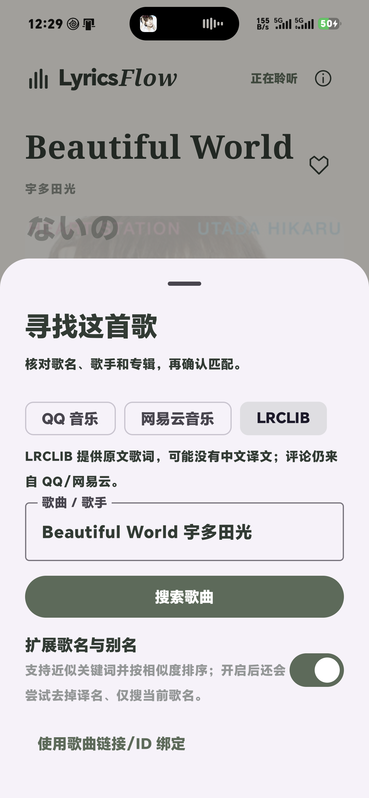
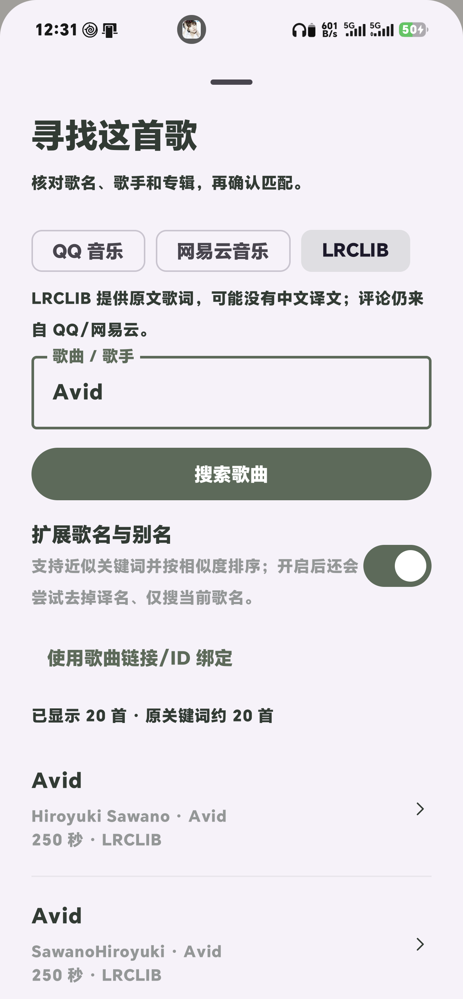
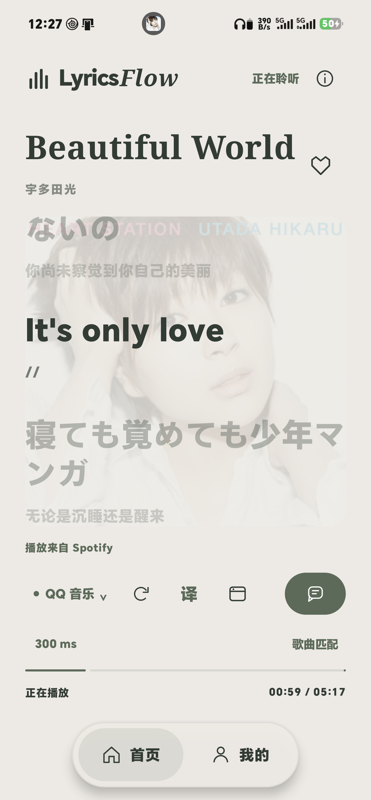

# 切歌自动匹配与 LRCLIB 入口修复

核实日期：2026-10-27。更新版已安装到 HONOR 真机，安装文件哈希与本地构建一致。

后续发现此版元数据等待与校准设置方法同名，导致误写 300 ms，已在后续补丁修复并归零；详见 [校准修复](./Calibration-Zero.md)。下方保留本阶段匹配结果和 APK 哈希。

## 根因

1. **搜索有结果，但歌手信息被拒绝。** 截图中的 `Avid` 在 QQ 能返回原版，Spotify 写 `SawanoHiroyuki[nZk], mizuki`，QQ 写 `SawanoHiroyuki[nZk] / 瑞葵`，网易云写 `SawanoHiroyuki[nZk] / 瑞葵(mizuki)`。原规则没有正确拆分逗号分隔的合作歌手，也不能利用括号中的拉丁别名。
2. **多专辑收录被全部当成不确定录音。** 网易云返回单曲、`Avid / Hands Up to the Sky`、`V` 等记录，时长约 249–250 秒。旧规则要求只有一个候选或专辑字符串唯一相等，否则拒绝；有歌也会显示“未找到可靠匹配”。
3. **切歌默认只查 QQ。** 新曲目未选择过来源时总回到 QQ，QQ 未匹配后不自动尝试网易云／LRCLIB，人工切源也没有成为之后新歌的优先项。
4. **元数据晚到不触发重试。** 曲名／歌手已到而时长仍为 0 时可能先匹配失败；后续只有时长更新、曲目 key 未变，原先不会重试。
5. **两个来源入口写了不同列表。** 来源菜单有 QQ／网易云／LRCLIB，但 `SearchSheet` 只写 QQ／网易云；初始化时还把所有非 QQ 来源映射为网易云，因此选了 LRCLIB 进入匹配窗口也会丢失选择。

《ホロネス》样本用于日语译名／歌手括号别名回归，不把截图里已显示歌词的状态算作一次匹配失败。

## 修改后的策略

### 确认同一录音

- 解析逗号、斜线、分号、`feat` 等合作歌手分隔；同一歌手括号内别名和主名称保留在一组。`瑞葵(mizuki)` 可对应 `mizuki`，`美波 (みなみ)` 可对应 `美波`，`[nZk]` 不作为可丢弃的括号译名。
- 歌手组需要对应，不因主歌手一样就接受另一位主唱／缺失主唱的候选。没有凭空加入全局 `mizuki=瑞葵` 硬编码；QQ 无法确认该别名时可使用有对应信息的网易云候选。
- 保留歌名／版本与时长限制，Live、混音、伴奏、语言版等不能按普通括号删掉。已知时长仍要求相差不超过 5 秒。
- 多条候选时先找规范化后唯一对应的专辑；否则仅当歌手、歌名／版本一致，候选时长范围不超过 2 秒且播放时长已知时，按最接近时长选择多发行记录。存在不同录音或证据不足仍请用户确认。
- 这属于元数据判断，不是音频指纹识别，不保证所有发行／同名录音都能自动分辨。

### 多源回退与状态管理

- 默认开启“自动尝试其他歌词源”：先查优先来源，失败、无歌词或接口不可用时依次尝试剩余来源；每个来源至多一次。优先 QQ 时为 QQ → 网易云 → LRCLIB。
- 首页显示实际歌词来源；换源时补充“已自动使用……”说明。不把网易云结果标成 QQ。评论源保持独立，不加入不支持评论的 LRCLIB。
- 无时间轴歌词保留为最后降级，优先寻找真正同步歌词；全部失败时分别说明每个来源无候选、歌手无法确认、时长／版本不符、录音歧义或接口错误，不再只给一句统一失败。
- 用户可关闭自动换源；手动选的优先来源在本机保存，用于之后未单独设置过的新曲目，已有逐曲选择优先保留。自动换源开关纳入设置备份。
- 切歌短暂等待 300 ms 收集元数据；若未解决曲目的时长从 0 变为有效值，会重新匹配。保留任务取消与代次校验，旧歌曲结果不能覆盖新歌。
- 自动流程设 30 秒协程预算，HTTP 仍有连接／读取时限；不会无限重试。阻塞网络调用取消可能等到其自身超时才完成，30 秒不是硬实时网络中断保证。

### LRCLIB 入口

歌曲匹配窗口共用三来源列表并保留当前选择；补齐 LRCLIB 记录 ID 和 `/api/get/<id>` 链接读取。评论匹配窗口明确只传 QQ／网易云两项。修正 LRCLIB 缺失 `plainLyrics` 时显示字符串 `null` 的问题。

LRCLIB 返回的是候选数组，并非完整命中总数；界面只显示已获取数量，不把数组长度冒充全库总数。官方协议依据：[LRCLIB API 文档](https://lrclib.net/docs)。

## 验证

| 检查 | 结果 |
| --- | --- |
| Avid 真实网易云候选 | 返回 23 个去重候选，选择 ID `2009678546`、249000 ms，歌词有时间轴 |
| ホロネス 真实 QQ 候选 | 返回 30 个候选，匹配 MID `004d2PCl0QeQvl`，歌词有时间轴 |
| 原时长 0、后更新到 249000 | 同一曲目 key 自动重试并取得 Avid 歌词 |
| Avid 优先 QQ | QQ 无法确认别名后，AppGraph 实际自动选择网易云并显示换源说明 |
| 快速切歌 | 第一首被取消，仅发布第二首缓存歌词 |
| LRCLIB 界面 | 当前 LRCLIB 选择保留；三来源均可见；记录 ID 输入框正确；切回 QQ 后字段恢复 |
| LRCLIB 真机联网 | 手动搜索 `Avid` 返回 20 条候选，包含 `Hiroyuki Sawano`、`SawanoHiroyuki` 的记录 |
| 真机现有 Spotify 会话 | 安装后读取用户正在播放的歌曲，界面实际显示原文／译文；本轮没有切换、暂停用户音频 |

首次主机 LRCLIB 请求曾返回 503，而后真机相同关键词搜索成功，说明不能仅凭某次网络错误断言服务永久不可用。界面会如实保留网络错误和回退入口。

回归：21 项 JVM 单测（时间轴等 10 项、搜索匹配 6 项、多源解析 4 项、模板 1 项）；20 项设备集成。具体日志：[完整测试](./automatic-matching-final-run.log)、[匹配专项](./automatic-matching-focused.log)、[构建](./automatic-matching-build.log)、[Lint](./automatic-matching-lint.txt)、[解析单测](./automatic-matching-unit-resolver.xml)、[匹配单测](./automatic-matching-unit-search.xml)。Lint 0 错误、37 警告。

独立重复测试曾出现注入的测试元数据被真实 Application 监听启动回调影响的夹具失败，保留 [记录](./automatic-matching-fixture-startup-failure.log)。夹具改用隔离 AppGraph 后重跑通过；没有禁止生产监听或放宽匹配断言。注入测试元数据不算真实 Spotify 进程联调证据。

另一次分页界面测试假定两页去重后一定为 60 首，但实测平台两页有重叠，第二页仅新增 27 个 ID。已改为固定 QQ 测试来源、检查新增候选数大于 30 且不超过 60，继续验证去重与清除旧结果；[原断言失败记录](./automatic-matching-pagination-assumption-failure.log)保留。

## 截图







## 复现与产物

```powershell
.\scripts\Run-AndroidQa.ps1 -Device emulator-5554 -IncludeNetwork
```

APK：`app/build/outputs/apk/debug/app-debug.apk`，12,285,758 字节。SHA-256：`DE071B00E4350FBC0C499089D537110B926F07CB37AD6A321AA09D13AC61D3FA`。

尚未统计整库自动匹配成功率，也没有验证所有歌手跨语言名称、所有录音版本、LRCLIB 所有记录或长期后台稳定性。证据不足时仍应人工绑定，不用任意降低门槛来隐藏匹配失败。
