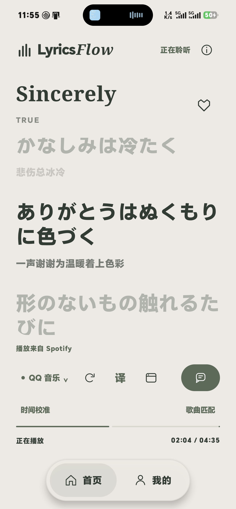
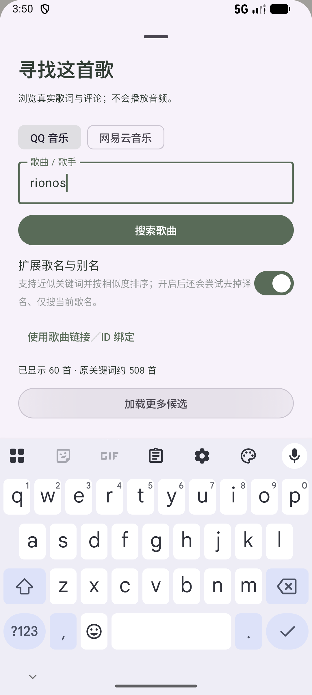

# QQ 译文与歌曲搜索优化

核实日期：2026-10-27。更新后的开发版已安装到用户的 HONOR 真机。

## 结论与原因

**QQ 有可用译文接口，原实现也已读取旧接口的 `trans` 字段。** 本次同一 MID `001CNiOJ3VyAHu`（ウィアートル / rionos）的旧接口返回 22 行原文、空 `trans`；新接口返回 22 行原文和 22 行按时间戳对应的译文。问题不等于曲库没有译文，旧接口和旧缓存是这首歌缺译文的原因。

搜索结果少的主要原因是 Desktop 搜索常返回成功但空列表，随后降级到通常只有约 4 首的 Smartbox 搜索建议。旧代码又限制最多解析 4 条，界面没有后续页。人工候选原本没有完全相同过滤，严格相等检查位于自动匹配；这两处分别优化。

完整搜索已在 Android 验证：QQ `rionos` 首两页各 30 首，第二页有 30 个新 ID，接口报告共 508 首；网易云样本首两页各 30 首、报告总量 277。之前未匹配的 QQ 日语歌现已在真机自动匹配并加载 22 行歌词。

## 接口与实现

### QQ 原文及译文

原路径：`GET https://c.y.qq.com/lyric/fcgi-bin/fcg_query_lyric_new.fcg?songmid=<mid>&format=json&nobase64=1&g_tk=5381`。本次 `nobase64=1` 与社区常见 `platform=yqq` 参数形式均返回业务码 0，但样本 `trans` 长度为 0。

新路径为匿名只读 `POST https://u.y.qq.com/cgi-bin/musicu.fcg`，有效请求如下：

```json
{
  "comm": { "ct": 24, "cv": 4747474, "format": "json" },
  "lyric": {
    "module": "music.musichallSong.PlayLyricInfo",
    "method": "GetPlayLyricInfo",
    "param": {
      "songMid": "001CNiOJ3VyAHu",
      "crypt": 0,
      "qrc": 0,
      "trans": 1,
      "roma": 0,
      "lrc_t": 0,
      "qrc_t": 0,
      "trans_t": 0,
      "roma_t": 0,
      "type": 1
    }
  }
}
```

验证外层／子模块业务码，读取 `lyric.data.lyric`、`lyric.data.trans`。当前 `crypt=0` 样本是 Base64 UTF-8 LRC，原文与译文 22 个时间戳完全对应。原文和时间不改写，译文标记为来源译文。新接口优先，失败可降级原逐行接口；缺译文时如实提示换来源或配置在线翻译，不自动调用收费大模型。

`QqLyricCodec` 兼容 Base64、HTML 实体，拒绝非法 UTF-8、控制字符及不支持的加密内容。没有加入加密 QRC 解码，也没有把二进制罗马音当作文本显示。

依据：[维护者的歌词接口定义](https://github.com/L-1124/QQMusicApi/blob/main/qqmusic_api/modules/lyric.py)、[公共版本参数](https://github.com/L-1124/QQMusicApi/blob/main/qqmusic_api/core/versioning.py)、[另一维护者对字段编码的记录](https://github.com/chongya369/qqmusic-api-py/blob/main/qqmusic/apis/lyric.py)。文档中的加密形式与本次选择的 `crypt=0` 返回不同，以字段验证为准。它们属于非官方接口，不是正式开放平台服务契约。

### 完整搜索

```text
GET https://c.y.qq.com/soso/fcgi-bin/client_search_cp
    ?w=<关键词>&format=json&n=30&p=<从1开始的页码>&cr=1&t=0&g_tk=5381
```

读取 `data.song.list`、`totalnum`，兼容旧字段 `songname`、`songmid`、`songid`、`albumname`、`interval`，无需逐个查详情才能展示。完整搜索失败才尝试 Desktop／建议，并显示降级说明。后续页固定当前通道，失败保留重试入口，不把另一端点第一页伪装成第二页。

另一次主机检查中 `search_for_qq_cp` 也返回 30 条；实际代码选用已在 Android 分页验证的 `client_search_cp`。旧接口可能随网络／时间变化，之前一次空列表不能当作永久失效。依据：[维护者的完整搜索、建议及分页实现](https://github.com/jsososo/QQMusicApi/blob/master/routes/search.js)。

## 搜索和自动绑定的区别

| 场景 | 当前行为 |
| --- | --- |
| 歌名片段、歌手、近似拼写 | 平台关键词召回后保留所有候选，按规范化文本／编辑距离排序，不只展示完全相同的歌名 |
| 括号译名 | 规范化全角／半角、大小写和标点；可扩展 `ウィアートル (旅人) rionos` 为原名＋歌手、仅原名 |
| 扩展范围 | 最多 3 种查询；“扩展歌名与别名”可关闭额外查询；本地排序和平台关键词搜索继续有效 |
| 分页 | 每个查询每页 30 条；列表前后提供“加载更多候选”；按平台＋歌曲 ID 去重，重复页停止续页 |
| 数量 | 分别显示已加载数量和原关键词报告的约数，不把重叠扩展查询的总数相加 |
| 请求竞态 | 改关键词／切来源会取消旧任务并清除结果、数量和游标；迟到响应受版本检查保护 |
| 自动绑定 | 规范化歌名或译名对应、歌手符合、已知时长差不超过 5 秒；多个版本只在专辑唯一匹配时自动选择，否则人工确认 |
| 版本保护 | 保留 Live、翻唱、混音、伴奏、语言版等限定，不因去括号自动绑到另一版本 |
| 手动绑定 | 链接／ID 入口保留，默认收起以减少占位 |

自动匹配只检查有限扩展查询的首屏，人工可继续加载更深结果。每次弹窗最多保留 300 首，页码上限 100 页，达到展示上限后提示缩小关键词。搜索缓存有效期 5 分钟。

这里的模糊搜索是平台关键词召回、有限查询扩展和本地相似度排序；本地排序不能创造平台没有返回的歌曲，也不保证任意错别字都命中。

## 缓存升级

歌词 JSON 新增可选 `providerRevision`，旧文件缺失时按 0 读取，无需修改数据库表。QQ 新接口记为 2、旧接口降级记为 1。旧 QQ 缓存先显示并触发升级，失败仍保留旧歌词，后续主动刷新／重新加载可再尝试。

同一时间戳且原文未变的行，如果新来源没有译文，保留已有译文、类型和模型信息；来源有译文则采用来源译文。没有清空用户歌词库、绑定或凭证。

## 验证

- 最终构建、Debug App／测试 APK、15 项 JVM 单测、Lint 成功：[构建](./qq-discovery-build.log)、[搜索单测](./qq-discovery-unit-search.xml)。其中业务单测 14 项（时间轴等 10 项＋搜索 4 项），另有模板算术测试 1 项。Lint 0 错误／37 警告：[明细](./qq-discovery-lint.txt)。
- 最终模拟器 **15 项集成通过**：[日志](./qq-discovery-all-tests.log)。涵盖现有播放、界面、导入安全、QQ／网易云歌词和评论，以及译文、分页、缓存迁移和搜索界面。
- 专项 5 项：[记录](./qq-discovery-emulator.log)。QQ 22 行原文／22 行译文、两页各 30 首且第二页有 30 个新 ID、网易云分页、编码与缓存升级均通过。
- 搜索界面执行“输入 rionos → 30 首 → 加载更多 → 60 首 → 改查询清除结果 → 展开 ID 绑定”。最终构建在完整 15 项中也通过该流程。较早独立界面测试：[日志](./qq-search-ui.log)。
- 真机 QQ 初轮 `ウィアートル (旅人)` 自动匹配 22 行：[记录](./qq-discovery-real-player.log)。最终构建实际曲目 `1991` 的连接、暂停、seek、重连及时间歌词检查通过，加载 36 行：[记录](./qq-discovery-real-player-final.log)。
- 最终真机 Spotify `Sincerely` 的连接与播放状态回归通过，加载 QQ 来源 39 行：[记录](./qq-discovery-spotify-regression.log)。下面截图可见日文、中文译文及独立的播放／歌词来源标记。





一轮 Spotify 暂停检查曾捕获进度从 27881 ms 变成 902 ms，保留 [失败记录](./qq-discovery-spotify-interrupted.log)。该阶段实际曲目也在变化，现有证据不足以把它归因为歌词接口；未修改播放监听逻辑或放宽断言，后续固定当前曲目 `Sincerely` 重跑通过。该轮失败不算通过样本。

没有调用 DeepSeek 等收费服务，也没有完成整库译文覆盖率、所有错别字、多地区或长时间后台验收。匿名接口可能出现 DNS／TLS 波动或平台变更。

## 复现与产物

```powershell
# 构建、15 项单测、Lint、15 项集成（含真实匿名接口）
.\scripts\Run-AndroidQa.ps1 -Device emulator-5554 -IncludeNetwork
# 真机已有歌曲会话时验证连接和时间歌词
.\scripts\Run-RealPlayerQa.ps1 -Device <serial> -Player QQ -RequireLyrics -SkipBuild
```

APK：`app/build/outputs/apk/debug/app-debug.apk`，12,545,447 字节。SHA-256：`5D61830AEFA7DE58B92C0482E77EE7D52ABFEB4D0656269A3D67B46B5849BDD5`。
