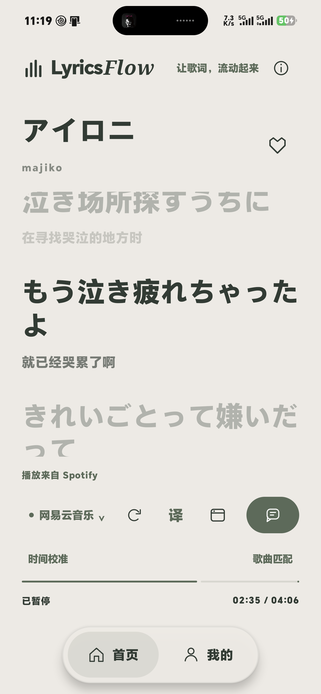
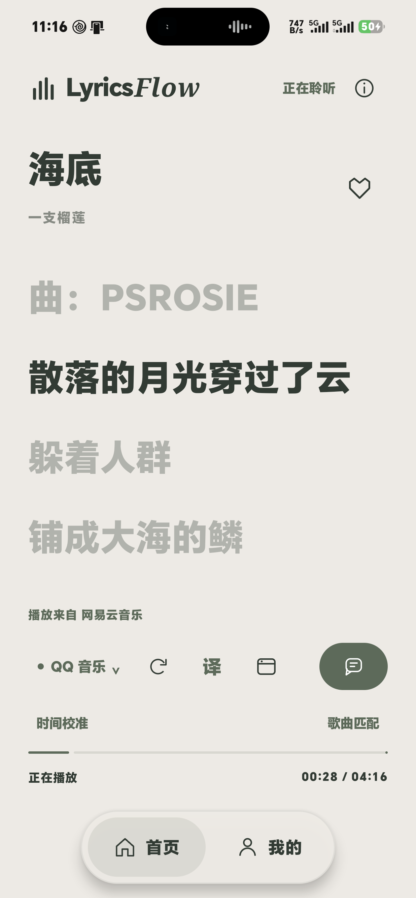
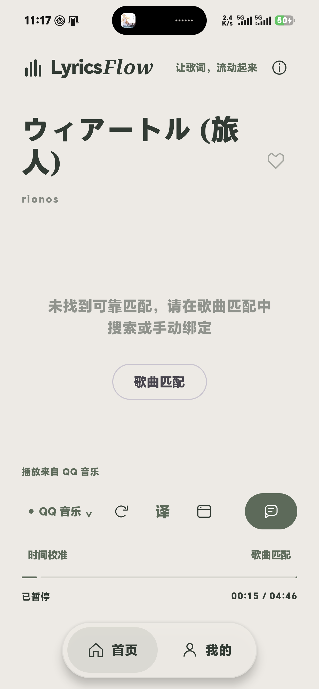

# 真机音乐播放器联调

测试日期：2026-10-27。更新后的开发版已安装到用户提供的 HONOR MLY-AN00 真机。

## 结论

**Spotify 本机连接已通过真机验证**，并非模拟 Spotify 的受控测试。QQ 音乐、网易云音乐的真实本机播放会话也均已连接。三款 App 的曲目识别、播放进度推进、暂停冻结、seek、恢复播放及监听重新连接均通过。

| 播放器 | 检测版本 | 实际测试曲目 | 最终检查 | 歌词结果 | 采样时进度差 |
| --- | --- | --- | --- | --- | --- |
| Spotify | 9.1.92.3058 | アイロニ / majiko | 4/4 通过 | 网易云来源 70 行时间歌词，同步行检查通过 | 0 ms |
| QQ 音乐 | 20.9.5.8 | ウィアートル (旅人) / rionos | 4/4 通过 | 当前歌曲未自动可靠匹配；显示搜索／手动绑定入口 | 1 ms |
| 网易云音乐 | 9.6.13 | 海底 / 一支榴莲 | 4/4 通过 | QQ 来源 49 行时间歌词，同步行检查通过 | 0 ms |

进度差是读取应用快照与播放器 MediaSession、按同一单调时钟计算所得的单次差值，不能理解为声学同步误差始终为零。最终歌词检查使用已写入本机缓存的真实来源歌词，不代表本次每轮重跑都重新访问歌词接口。播放器与歌词来源相互独立；例如 Spotify 播放、网易云提供歌词属于正常设计。

每款的四项检查包含两项共用的元数据适配回归、一项真实播放器元数据检查和一项真实播放流程，不是十二个互不重复的用例。

日志：[Spotify](./real-spotify-instrumentation.log)、[QQ 音乐](./real-qq-instrumentation.log)、[网易云音乐](./real-netease-instrumentation.log)。

## 环境与连接方式

- ADB 检测机型 `MLY_AN00`，系统上报 Android `17` / API `37`，构建 `MLY-AN00 11.0.0.111(SP7C00E111R101P2)`。这些是设备返回值。
- 安装 `com.example.lyricsflow` 开发版，并为本应用授予通知使用权。保留手机上已有的其他通知监听器，没有覆盖整份系统监听器设置。
- 通过 Android `NotificationListenerService` 获得 `MediaSessionManager` 访问权，监听允许列表中的真实播放器。三款会话均确认 `PLAYBACK_TYPE_LOCAL`。
- Spotify 本机监听不依赖 Spotify OAuth、开发者 Client ID 或 Spotify Web API Key；依赖 Spotify 已有本机播放会话和系统通知使用权。手机已有的 Spotify 登录状态没有被修改。
- 本轮未读取翻译配置文件、未使用 DeepSeek Key，也未调用收费翻译。

## 修复

### QQ 蓝牙／车载歌词污染标准曲名

真机最初返回的标准 `TITLE` 是随播放变化的当前歌词，`ARTIST` 是“歌名-歌手”。这会让应用每行都误判为一首新歌，重复清空和匹配歌词。

只针对 QQ 音乐，优先读取实际观测到的 `ucar.media.metadata.UCAR_TITLE` / `UCAR_ARTIST`；缺失时回退标准字段，歌手还可回退 `ALBUM_ARTIST`。Spotify 和其他播放器继续使用标准字段。没有修改 QQ 音乐的蓝牙歌词设置。

真实原始观测见 [QQ 元数据日志](./real-qq-metadata.log)。新增回归使用两段不同歌词构造同一首歌，确认曲目 key 保持一致；另行检查普通 QQ、Spotify 和缺失元数据的回退。

### 暂停后跳到旧的 Spotify 会话

原实现没有正在播放的会话时，总会优先选一个旧的 Spotify 暂停会话。在网易云暂停测试中，应用因此读到另一首歌的进度，差约 107 秒。失败记录保留在 [修复前日志](./real-netease-before-fix.log)。

修正后的自动仲裁：固定播放器偏好 → 正在播放的 Spotify → 最近更新的其他播放会话 → 仍然存在的当前会话 → 最近更新的暂停会话。因此暂停不换播放器；监听断开再连接时，也按最近会话恢复。真实测试额外执行断开／重连，确认暂停曲目与进度不丢失。

### 明确连接来源和窄屏操作

首页新增“播放来自 Spotify／QQ 音乐／网易云音乐”，设置页新增当前连接和重新检测入口。歌词来源选择与播放器标识分别显示。真机窄屏下评论按钮改用带无障碍说明的图标，防止文字被挤成竖排；宽屏保留“共鸣”文字。

## 截图

Spotify：截图在测试完成、恢复原先暂停状态后获取，界面清晰显示“播放来自 Spotify”和网易云歌词来源。



网易云：播放来自网易云音乐，歌词来自 QQ；截图中可见当前同步行。



QQ：已连接并显示正确曲目和进度，歌词匹配失败如实提示。



## 检查流程与复现

先在手机对应音乐 App 中选好一首可播放的歌曲。脚本会安装开发版／测试 APK，授予本应用通知使用权；真实流程会短暂播放、暂停和 seek 当前歌曲，在未切歌时尝试恢复原有位置与播放状态，同时恢复应用原有偏好。测试期间不要手动切歌。脚本不会点击收藏、发表评论、开通会员或调用 next／previous。

```powershell
# Device 替换为 adb devices 返回的真机序列号。
.\scripts\Run-RealPlayerQa.ps1 -Device <serial> -Player Spotify -RequireLyrics
.\scripts\Run-RealPlayerQa.ps1 -Device <serial> -Player NetEase -RequireLyrics -SkipBuild
.\scripts\Run-RealPlayerQa.ps1 -Device <serial> -Player QQ -SkipBuild
```

`-RequireLyrics` 对来源时间歌词和当前同步行增加断言；不是播放器连接的前提。QQ 的严格歌词模式曾因当前歌曲未匹配而失败，保留在 [歌词匹配失败日志](./real-qq-unmatched-lyrics.log)，不能把最终连接测试通过写成 QQ 当前歌曲歌词也已通过。需要截图时增加 `-CaptureWindow`，流程结果发出后留出 15 秒窗口，可通过 Android CLI 截图。

真实控制测试默认跳过，必须显式传 `allowRealPlayer=true` 与播放器包名才会执行。普通模拟器 QA 不会控制用户手机播放器。实现见 `RealPlayerIntegrationTest.kt`；脚本会同时检查 JUnit 成功摘要和真实流程结果，避免 `am instrument` 失败却退出 0 被误判为成功。

## 构建与回归

- Android CLI：`assembleDebug`、`assembleDebugAndroidTest`、`testDebugUnitTest`、`lintDebug` 全部通过；[构建日志](./real-player-build.log)。
- JVM 10 项单元测试通过：[结果](./real-player-unit-tests.xml)。Lint 0 错误、37 警告：[明细](./real-player-lint.txt)。
- 手机虚拟机新增 QQ 元数据适配后，6 项核心设备回归全部通过：[结果](./instrumentation-emulator-5554.log)。
- 真机可用的应用 UID 过滤 crash 缓冲未发现 LyricsFlow 崩溃记录：[检查结果](./real-player-crashes.log)。
- 当前 APK SHA-256：`530A566C504FB2E5813386B15D6481EA2FB948589CF114E9802B6D36511D6217`。

## 尚未验证的范围

本次证明这台真机、上述播放器版本、已有登录和本机歌曲下的连接及状态同步。当前 QQ 歌曲自动歌词匹配仍需人工绑定；没有通过忽略歌手、时长或版本差异来强行匹配。首轮还曾出现 QQ 域名 DNS 失败，后续请求和现有缓存可用；没有把临时网络故障当作播放器连接失败。

没有完成连续十首、60 分钟、厂商杀进程／省电策略、重启、锁屏长时间播放、Spotify 远程设备、多账号或会员权益差异验收，也没有在其他型号真机上作保证。需要持续后台悬浮歌词时，仍按应用正常流程单独授权并开启悬浮窗；本次没有调整系统全局省电策略。

连接方式参考 Android 官方 [媒体控制器测试说明](https://developer.android.com/media/optimize/mct)，元数据私有字段的适配依据本机真实返回值。
